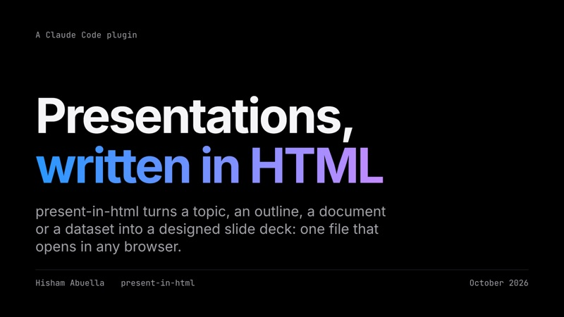

<p align="center">
  
</p>

<h1 align="center">present-in-html</h1>

<p align="center">
  <b>Presentations, written in HTML.</b><br>
  A Claude Code plugin that turns a topic, an outline, a document or a dataset into a designed slide deck:<br>
  one HTML file that opens in any browser, presents itself and prints to PDF.
</p>

<p align="center">
  <a href="https://hisham-abuella.github.io/present-in-html/"><b>Website and template library</b></a> ·
  <a href="https://hisham-abuella.github.io/present-in-html/tour.html">Take the tour</a> ·
  <a href="https://github.com/hisham-abuella/present-in-html/issues/new/choose">Feedback</a>
</p>

<p align="center">
  <a href="https://hisham-abuella.github.io/present-in-html/tour.html"></a>
</p>

## Install

In Claude Code:

```
/plugin marketplace add hisham-abuella/present-in-html
/plugin install present-in-html@present-in-html-marketplace
```

Then ask for a presentation. That's it.

## The skills

You don't need to name them: Claude picks the right one from what you ask.

| Skill | What it does | Ask something like |
|---|---|---|
| **present-in-html** | Makes a deck from a topic, an outline, files (PDF, Word, notes), data (CSV, Excel) or links. Picks a look for your audience, writes speaker notes and checks every slide. | "Turn `q3-report.pdf` into a 10-minute board deck" |
| **edit-deck** | Opens your deck in a click-and-type editor in the browser, to fix wording and notes yourself. Save writes the same file. | "Let me fix the wording myself" |
| **review-deck** | Reviews a deck against its audience and time slot: timing, jargon, story, sources. Gives a verdict and concrete fixes. | "Will this fit in 15 minutes for non-technical managers?" |
| **publish-deck** | Publishes the deck and its images to GitHub Pages and gives you a link to share. | "Put my deck online so I can send a link" |
| **deck-workflow** | Runs the whole thing: plan, build, review, fix, publish, or picks it up at any step. | "Plan, build and review a 12-minute board deck from q3.pdf" |

## The workflow

Each step is done by the agent and model that suit it, handing off through files in one folder:

| Step | Agent | Model | Output |
|---|---|---|---|
| 1. Plan | deck-planner | Opus | `PLAN.md`: promise, story, look, one row per slide |
| 2. Build | deck-builder | Sonnet | the deck, checked in every theme |
| 3. Review | deck-reviewer | Opus | `REVIEW.md`: PASS or FIX (audience, time, Winston's speaking rules, errors) |
| 3b. Fix | deck-builder | Sonnet | fixes the blocking items, then it is reviewed again (up to 2 rounds) |
| 4. Publish | deck-publisher | Sonnet | a GitHub Pages link, only after you approve |

Run it with `/present-in-html:make-deck` (plan to review) and `/present-in-html:publish-deck` (after your yes), or just ask.
Start anywhere: with a request it plans, with a `PLAN.md` it builds, with a finished deck it reviews. Edit the wording
yourself at any point with edit-deck. Without Claude Code's dynamic workflows, the same agents run one after another.

## What you get

One `.html` file. Open it in Chrome and press **F** for fullscreen, **P** for the presenter window (notes, next slide,
timer), **G** for an overview of every slide, **S** to try another theme, **A** to play its narration when the deck has
voice clips. Print to PDF with Cmd/Ctrl+P.

32 themes (26 made for a profession, from clinician to lawyer to founder), 28 layouts, charts from your data, builds and
Magic Move, narration (one voice clip per slide; the How it works and Slides that run examples are narrated), and Arabic/RTL. See them all on the **[website](https://hisham-abuella.github.io/present-in-html/)**: every
example deck and look opens live in your browser.

## Feedback, bugs and ideas

[Open an issue](https://github.com/hisham-abuella/present-in-html/issues/new/choose) and pick a form:
[bug report](https://github.com/hisham-abuella/present-in-html/issues/new?template=bug_report.yml),
[feature request](https://github.com/hisham-abuella/present-in-html/issues/new?template=feature_request.yml), or
[feedback](https://github.com/hisham-abuella/present-in-html/issues/new?template=feedback.yml) on how it worked for a real talk.

<details>
<summary><b>More install options and the repository layout</b></summary>

**Update:** `/plugin update present-in-html@present-in-html-marketplace`

**From a local clone:** `/plugin marketplace add ./present-in-html`

**Without the plugin system:** `./install-skill.sh` copies the skills into `~/.claude/skills/` (or this project's
`.claude/skills/`). The agents and workflows need the plugin install.

**The slide checker** uses Playwright. Install it once, outside the plugin folder:

```bash
mkdir -p ~/.kp-tools && cd ~/.kp-tools && npm i playwright && npx playwright install chromium
```

| Path | What it is |
|------|------------|
| `plugins/present-in-html/` | The plugin: five skills, four agents (`agents/`) and two workflows (`workflows/`). Only this folder is installed |
| `keynote-pro/` | The slide engine's source (Keynote Pro): build tools, themes, examples, profession library |
| `scripts/build-plugin.sh` | Syncs the engine into the plugin (`--check` reports drift) |
| `scripts/build-home.mjs` | Regenerates the website (`index.html`) |
| `index.html`, `tour.html`, `gallery/`, `assets/` | The website, the tour deck, thumbnails and the logo |
| `evals/` | Test prompts for the skills |
| `legacy/` | Earlier formats (markdown keynote, Stories), archived |

</details>

## Author

Made by **Hisham Abuella**: [hishamabuella.com](https://www.hishamabuella.com) · [GitHub](https://github.com/hisham-abuella)

## License

[MIT](LICENSE) © 2026 Hisham Abuella. The plugin and each skill carry their own copy of the license.
