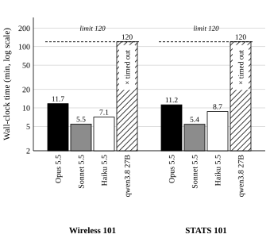
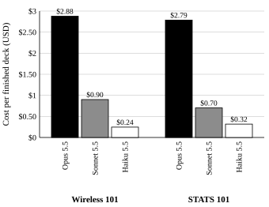
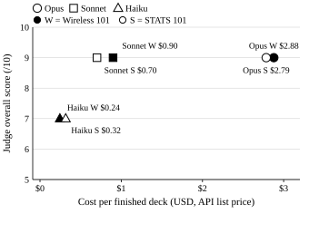
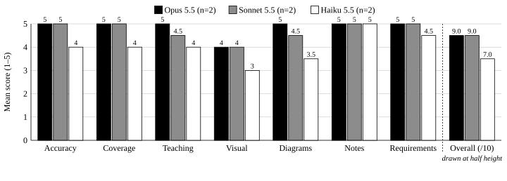
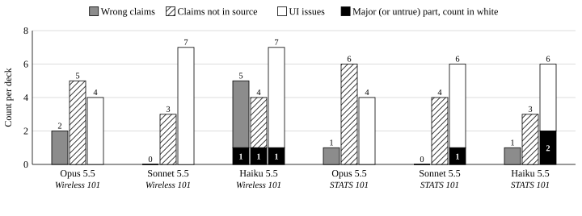
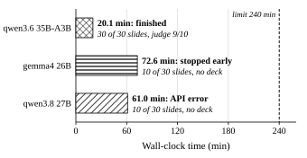

# LLM agents على الـ cloud ولا على جهازك؟ تحضير slides محاضرة بـ Agent Skill: دراسة أولية للتكلفة والوقت والجودة
*Cloud vs. Local LLM Agents for Generating Lecture Slides with an Agent Skill: A Preliminary Cost–Time–Quality Study*
**هشام أبو العلا**
*Cellular Systems Engineer | الآراء دي آرائي الشخصية*

---

## الملخص

الـ coding agents بقت تقدر تبني deck كامل لوحدها لو مشيت ورا Agent Skill جاهزة. السؤال هنا: إيه الفرق بين الـ cloud models والـ models المحلية في الشغلانة دي، من ناحية الوقت والتكلفة والجودة؟ إدّينا تلات cloud models (Opus 5.5، Sonnet 5.5، Haiku 5.5) وmodel محلي واحد (qwen3.8 27B، شغّال عن طريق Ollama على Mac Studio بـ Apple M4 Max) نفس الطلب، مرة واحدة ومن غير أسئلة: حوّل module من كورس لـ deck محاضرة مدتها 50 دقيقة، فيه 20–30 slide، باستخدام الـ skill اللي اسمها present-in-html في Claude Code. جرّبنا على مادتين (Wireless 101 وSTATS 101). الـ decks اتقيّمت بالـ checker بتاع الـ skill، وبعدّ عناصرها، وبـ LLM judge blind (مش عارف مين عمل الـ deck) على سبعة معايير. الـ runs الستة على الـ cloud خلصت كلها في 5.4–11.7 دقيقة؛ Opus وSonnet خدوا 9/10 في المادتين، وHaiku خد 7/10. الـ dense model المحلي ما خلّصش ولا مادة في 120 دقيقة. وفي تجربة منفصلة، مش داخلة في المقارنة دي، Opus كتب plan واحدة مفصّلة وتلات models محلية بنوا منها؛ واحد منهم، الـ mixture-of-experts model اللي اسمه qwen3.6 35B-A3B، خلّص deck الـ judge إدّاله 9/10. كل خانة هنا run واحد بس، فدي مؤشرات أولية، مش نتايج نهائية.

**الكلمات المفتاحية**: large language models، LLM agents، Agent Skills، توليد الـ slides، الـ inference المحلي، mixture of experts، LLM-as-a-judge، الموازنة بين التكلفة والجودة.

---

## I. المقدمة

تحضير deck محاضرة من module في كورس شغل بطيء ومتكرر. أدوات الـ agentic coding زي Claude Code بقت تقدر في session واحدة تقرا ملف المصدر، وتنده tools، وتكتب HTML، وتشغّل checker، وهي ماشية ورا Agent Skill جاهزة [16]. والسؤال اللي يهم محاضر أو فريق صغير سؤال عملي: أنهي model المفروض يشغّل الـ agent ده؟ وهل الـ model اللي على جهازك كويس كفاية؟

الـ cloud models سريعة، بس بتدفع على كل token. الـ models المحلية مفيهاش فلوس على الـ token، والمادة بتفضل على جهازك، بس هي أصغر وشغالة على hardware عادي زي اللي عند أي مستخدم. الـ agent benchmarks اللي اتعملت قبل كده بتقول إن فيه فجوة واضحة بين الـ models التجارية والـ open-weight models في استخدام الـ tools على كذا turn [5]. وإحنا كنا عايزين نشوف الفجوة دي شكلها إيه في مهمة كتابة واحدة حقيقية، من أولها لآخرها.

الورقة دي بتعرض دراسة صغيرة بتشغّل نفس الـ skill ونفس الـ harness ونفس الـ prompt على أربع models (تلاتة cloud وواحد محلي)، وبتقيس الـ wall-clock time والتكلفة والجودة حسب تقييم الـ judge. وبتعرض كمان تجربة منفصلة الـ models المحلية فيها بتبني من plan كتبها cloud model. اللي الورقة بتضيفه:

- harness تقدر تعيد بيه التجربة، بيشغّل Claude Code ‏headless [15] بالـ cloud models، وبالـ models المحلية عن طريق الـ endpoint بتاع Ollama المتوافق مع Anthropic [14]، وكل run في folder معزول.
- طريقة تقييم من تلات أجزاء: الـ checker التلقائي بتاع الـ skill، وعدّ لعناصر الـ deck، وLLM judge blind بـ rubric من سبعة معايير وقايمة ملاحظات بالتفصيل.
- نتايج لمادتين، وكمان تجربة منفصلة تلات models محلية فيها بتبني من plan واحدة كتبها Opus، ومعاها كل الـ prompts، والـ plan، والـ transcripts، ومخرجات الـ judge، والـ decks منشورة.
- ملاحظات على الـ skill نفسها، منها ثغرة في الـ checker بتخلّي template محدش ملاه يعدّي.

باختصار، النتايج بتقول إن Sonnet 5.5 جاب نفس جودة Opus 5.5 عند الـ judge في حوالي نص الوقت، وبربع لتلت التكلفة، وإن الـ dense model المحلي كان أبطأ من إنه يخلّص لوحده. والتجربة المنفصلة (القسم V) بتقول إن plan يكتبها model قوي ممكن تخلّي الـ build المحلي يمشي.

## II. الشغل السابق

**توليد الـ slides.** DOC2PPT قدّم تحويل الـ document لـ slides كمهمة لوحدها [8]. PPTAgent بيعمل presentations بـ agent بيعدّل slides مرجعية، وبيقيّمها بـ rubric معتمد على LLM بيغطي المحتوى والتصميم والترابط [9]. AutoPresent بيعمل الـ slides على شكل برامج، وبيعمل benchmark لـ open models صغيرة قصاد الـ frontier models [10]. الوضع عندنا أقرب حاجة لـ AutoPresent: الـ deck عبارة عن code (ملف HTML واحد)، بس اللي بيعمله coding agent عام ماشي ورا skill، مش model معمول مخصوص للمهمة.

**الـ agents والـ benchmarks.** ReAct بيوصف الـ loop اللي أي agent بيستخدم tools بيمشي عليه: يفكّر، ويعمل action، ويشوف النتيجة، ويعيد [6]. SWE-bench بيقيّم الـ agents على مهام software طويلة وفيها خطوات كتير [4]، وAgentBench بيقول إن الـ API models سابقة الـ open-weight models في الشغل الـ agentic [5]. الـ Agent Skills بتجمع تعليمات وscripts وresources الـ agent بيحمّلها وقت ما يحتاجها [16]؛ والمهمة بتاعتنا بتختبر skill واحدة من دول من الأول للآخر.

**LLM-as-a-judge.** الـ LLM judges القوية بتتفق كويس مع تفضيلات البشر، بس عندها biases: بتتأثر بترتيب الإجابات، وبتميل للإجابات الأطول، ولإجاباتها هي [1]. G-Eval بيقيّم النص على معايير صريحة باستخدام LLM، وبيلاحظ إن ممكن يكون فيه ميل للنص اللي كاتبه LLM [3]. والـ LLM evaluators ممكن تعرف الكلام اللي هي كاتباه وتفضّله [2]، وده مهم هنا لأن الـ judge بتاعنا داخل المنافسة هو كمان. ومعيار الدقة عندنا معتمد على مفهومي الـ faithfulness والـ factual hallucination زي ما الـ survey في [11] بيشرحهم.

**خطّط ونفّذ.** ReWOO بيفصل الـ planner عن الـ workers، وبيوري إن قدرة التخطيط ممكن تتنقل من model كبير لـ model أصغر [7]. وتجربة الـ plan المنفصلة عندنا (القسم V) ماشية على نفس التقسيمة: cloud model بيخطط مرة واحدة، والـ models المحلية بتنفّذ.

**الـ inference المحلي والـ MoE.** الـ sparse mixture-of-experts models بتشغّل جزء بس من الـ parameters لكل token [12]، وده بيقلل الحسابات لكل token مقارنة بـ dense model حجمه الكلي قريب منه. اتنين من الـ models المحلية في الدراسة دي شغالين بصيغة MLX على Apple silicon [13]، والتالت، الـ MoE model، عبارة عن build من نوع Q4_K_M GGUF (ملحق A)؛ وكلهم شغالين على Ollama، اللي بيدعم جزء بس من الـ Anthropic Messages API [14].

## III. تصميم الدراسة وحدودها

### A. المهمة والمدخلات

كل مهمة فيها module كورس واحد بصيغة Markdown وprompt ثابت واحد. المادتين هما Module 1 من *Wireless 101* (الموجات، والـ decibels، والـ path loss، والـ link budget، والـ modulation، وShannon، والـ multiple access) وModule 1 من *STATS 101* (العينات، والانحياز، وأنواع المتغيرات، والرسوم البيانية، والنزعة المركزية، والتشتت، والقيم الشاذة، والـ z-scores، والارتباط). الاتنين بيطلبوا deck لمحاضرة مدتها 50 دقيقة لطلبة سنة أولى جامعة، بالشروط دي: 20–30 slide بنفس ترتيب الـ module؛ الحقايق والأرقام والمعادلات اللي في الملف بس؛ diagrams متحركة لما تفيد؛ placeholders للصور عليها captions؛ speaker notes على كل slide؛ quiz وsummary في الآخر؛ احفظه باسم `deck.html` وشغّل الـ checker بتاع الـ skill لحد ما يعدّي؛ ما تسألش ولا سؤال وخلّص مرة واحدة.

الفرق بين الـ prompts هو طريقة استدعاء الـ skill. الـ prompt بتاع Wireless بيبدأ بـ «Use the present-in-html skill to…»، فكل model قرر بنفسه إنه ينده الـ skill. أما الـ prompts بتوع STATS فبتبدأ بالـ slash command ‏`/present-in-html:present-in-html`، اللي بيحمّل الـ skill قبل أول turn.

### B. الـ models والـ hardware

الجدول I فيه الـ models. الـ cloud models اشتغلت عن طريق الـ Anthropic API؛ والـ models المحلية اشتغلت على Mac Studio واحد (Apple M4 Max) فيه 64 GB unified memory، عن طريق Ollama 0.40.5، وClaude Code متوجّه للـ endpoint بتاع Ollama المتوافق مع Anthropic [14]. كل الـ runs استخدمت الـ plugin ‏present-in-html نسخة 3.1.0 على الـ commit ‏ae03c20. المواصفات الكاملة للجهاز، ومعاها الـ architecture والـ quantization بتوع كل model محلي، موجودة في ملحق A [19].

**جدول I**
**الـ models وكانت شغالة فين**

| الـ model | الـ identifier | شغال على | المهام |
|---|---|---|---|
| Opus 5.5 | `claude-opus-5-5` | Anthropic API | Wireless 101، STATS 101؛ وكمان الـ judge، والـ planner في تجربة الـ plan |
| Sonnet 5.5 | `claude-sonnet-5-5` | Anthropic API | Wireless 101، STATS 101 |
| Haiku 5.5 | `claude-haiku-5-5` | Anthropic API | Wireless 101، STATS 101 |
| qwen3.8 27B (dense) | `qwen3.8:27b-mlx` | Apple M4 Max, 64 GB, Ollama 0.40.5 | Wireless 101، STATS 101؛ وكمان تجربة الـ plan |
| qwen3.6 35B-A3B (MoE, 3B active) | `qwen3.6:35b-a3b` | Apple M4 Max, 64 GB, Ollama 0.40.5 | تجربة الـ plan بس |
| gemma4 26B | `gemma4:26b-mlx` | Apple M4 Max, 64 GB, Ollama 0.40.5 | تجربة الـ plan بس |

**جدول II**
**إعدادات الـ run لكل مهمة**

| المهمة | الـ Run ID | Claude Code | حد الوقت | سقف الميزانية على الـ cloud |
|---|---|---|---|---|
| Wireless 101 | 20261016-000644 | 2.1.301 | 120 min | $20 لكل run |
| STATS 101 | 20261016-063639-stats-101 | 2.1.301 | 120 min | $20 لكل run |
| STATS 101 + plan (تجربة الـ plan، القسم V) | 20261016-214018-stats-101-planned | 2.1.302 | 240 min | $20 لكل run |

### C. الـ harness والعزل

كل run بيبدأ في folder جديد فاضي متعمل برّه الـ repository، مفيهوش غير ملف الـ module (ومعاه الـ plan في المهمة اللي فيها plan). الـ folder برّه الـ repository لأن Claude Code بيقرا `CLAUDE.md` من الـ folders اللي فوقه؛ والـ script بيرفض يبدأ لو أي folder فوقه فيه `CLAUDE.md` أو `.claude`. الـ CLI بيشتغل headless [15] من غير أي settings files ‏(`--setting-sources ""`)، ومن غير أي plugins غير plugin الدراسة (`--plugin-dir`) والتلات plugins اللي جايين built-in مع الـ CLI، ومن غير MCP servers ولا claude.ai connectors ‏(`--strict-mcp-config`)، ومن غير session محفوظة، والـ permissions متخطّية (bypassed)، وكل model على الـ effort الـ default بتاعه.

الـ runs بتشتغل واحد ورا التاني عشان ما يتنافسوش على الـ CPU أو الـ GPU أو الشبكة. كل model محلي بيتحمّل في الذاكرة قبل ما الساعة تبدأ، فوقت التحميل مش محسوب. والـ `init` event بتاع الـ CLI بيتحفظ في كل transcript، فتقدر تتأكد بعدين من الـ plugins والـ MCP servers اللي اتحمّلت.

### D. تجربة الـ plan (بنعرضها لوحدها)

بعيد عن المقارنة الأساسية، عملنا تجربة عشان نساعد الـ models المحلية تخلّص؛ بنعرضها في القسم V، ومش جزء من المقارنة. في المهمة دي اللي فيها plan، Opus 5.5 كتب الأول ملف `PLAN.md` واحد بـ prompt للتخطيط بس. الـ prompt ده بيطلب النص بالظبط لكل slide والـ speaker notes كاملة، وSVG جاهز للصق لكل diagram، وخطوات build مترقّمة فيها أوامر الـ shell، لأن الـ plan «هتتبني … بـ model محلي أصغر وأبطأ بكتير، عمره ما استخدم الـ skill دي». التخطيط خد 23m 20s و51 turn و101,973 output token، وكلّف $5.05 ‏($5.046)، وطلّع plan حجمها 94 KB.

الـ plan اتعدّلت بالإيد في مكانين قبل الـ builds: متغيّر الـ folder اللي اسمه `D` اتظبط على `$PWD` (كان شايل الـ temp folder بتاع الـ planner)، وملف الـ deck اتغيّر اسمه لـ `deck.html` عشان يطابق الـ build prompt. بعد كده كل model محلي خد الـ build prompt، اللي بيقوله يمشي ورا خطوات الـ build اللي في الـ plan، وما يعملش plan من جديد، وما يقراش الـ reference files بتاعة الـ skill إلا لو خطوة طلبت كده.

### E. التقييم

كل deck بيتقيّم بتلات طرق. الأولى: الـ checker بتاع الـ skill ‏(`check.mjs`) بيختبر الـ layout، والنص اللي خارج الـ safe area، وحجم الخط، والـ contrast، والـ charts البايظة، والـ notes الناقصة، وبياخد screenshot لكل slide. التانية: script عدّ بيسجّل عدد الـ slides، والـ slides اللي ليها notes، والـ diagrams، والـ slides المتحركة، والـ image placeholders، وهل فيه quiz ولا لأ.

التالتة: judge blind ‏(Opus 5.5، `claude-opus-5-5`) بيقيّم كل deck لوحده من غير ما يعرف أنهي model عمله، على طريقة الـ rubric-based LLM evaluation [1]، [3]. بيقرا المصدر، والطلب، ونص الـ slides والـ notes، ومخرجات الـ checker، وكل screenshot. وبيرجّع structured output [15] فيه كل claim غلط (الـ slide، والجملة، والتصحيح، major/minor)، وكل claim مش موجود في المصدر وهل هو صح ولا لأ، وكل مشكلة UI باينة في الـ screenshots، والأخطاء الكبيرة. وبيقيّم سبعة معايير، كل واحد من 1 لـ 5: الدقة، والتغطية، والتدريس، والشكل، والـ diagrams، والـ notes، والالتزام بالمطلوب. وبعدين بيدّي درجة إجمالية من 1 لـ 10 على سؤال: «الـ deck ده جاهز قد إيه إني أدرّس منه بكرة؟»

الوقت هو الـ wall-clock time للـ run كله؛ والـ API time هو الوقت اللي راح في انتظار الـ model. التكلفة هي الـ `total_cost_usd` اللي الـ CLI بيطلّعها، واللي الـ documentation بتوصفها إنها تقدير من ناحية الـ client [15]. الـ CLI بيطبع سعر للـ runs المحلية كمان، بس ده مش فلوس حقيقية بتتدفع؛ فإحنا بنسجّل الـ runs المحلية بـ $0 ومش بنحسب الكهربا. وتكلفة الـ judge ‏($0.61–$0.74 لكل deck خلص) محسوبة لوحدها.

### F. القيود والحاجات اللي ممكن تأثر على صحة النتايج

- **sample واحدة لكل خانة.** كل model اتشغّل مرة واحدة لكل مهمة (n = 1). مخرجات الـ LLMs بتختلف من run للتاني حتى مع settings ثابتة [18]، والفروق في الدرجات اللي أصغر من الـ variance بتاع الـ benchmark ملهاش معنى [17].
- **الـ judge بيفضّل نفسه.** الـ judge، Opus 5.5، هو كمان واحد من الـ models اللي بنقارنها، والـ cloud models التانيين من نفس العيلة. والـ LLM judges ممكن تفضّل مخرجاتها هي [2]، [1]. والـ blinding بيخبّي اسم الـ model، بس مش بيخبّي الأسلوب.
- **التكلفة تقدير.** تكاليف الـ cloud هي تقدير الـ CLI بسعر القايمة من ناحية الـ client [15]، مش فاتورة.
- **settings مختلفة للـ run اللي فيه plan.** الـ run ده استخدم Claude Code 2.1.302 بحد 240 دقيقة؛ والـ runs التانية استخدمت 2.1.301 بحد 120 دقيقة. عشان كده، ولأن الـ input بتاعه مختلف، بنعرضه كتجربة منفصلة ومش بنقارنه بالـ runs الأساسية.
- **plan متعدّلة بالإيد.** مسارين في الـ plan بتاعة Opus اتصلّحوا بالإيد. والـ `plan-prompt.txt` اللي في الـ artifacts هو النسخة المعدّلة، اللي بقت بتطلب المسارين الاتنين.
- **جهاز واحد.** كل النتايج المحلية جاية من M4 Max واحد فيه 64 GB؛ وأي hardware تاني هيدّي أوقات مختلفة.
- **API ناقص.** Ollama بيدعم جزء بس من الـ Anthropic Messages API [14]، وده ممكن يأثر على استخدام الـ tools والـ streaming في الـ models المحلية.
- **صياغة الـ prompt والـ rubric.** الـ prompt بتاع Wireless بيطلب من الـ model يستخدم الـ skill، أما الـ prompts بتوع STATS فبتحمّلها بـ slash command. والـ run بتاع Wireless اتقيّم والجمهور والمطلوب مكتوبين جوه الـ rubric؛ أما الـ runs بتوع STATS فالـ judge قرا الحاجات دي من الطلب.

## IV. النتايج

القسم ده بيغطي المقارنة الأساسية: الـ runs التمانية على Wireless 101 وSTATS 101. الجدول III فيه نتايجهم. التجربة المنفصلة بتاعة القسم V مش داخلة هنا.

**جدول III**
**النتايج الأساسية للمهمتين (run واحد لكل خانة)**

| المهمة | الـ model | شغال على | الحالة | الـ wall time | التكلفة (USD) | الـ slides | الـ checker | claims غلط (major) | مشاكل UI ‏(major) | الـ judge /10 |
|---|---|---|---|---|---|---|---|---|---|---|
| Wireless 101 | Opus 5.5 | cloud | خلص | 11m 44s | 2.88 | 30 | pass | 2 (0) | 4 (0) | **9** |
| Wireless 101 | Sonnet 5.5 | cloud | خلص | 5m 27s | 0.90 | 30 | pass | 0 (0) | 7 (0) | **9** |
| Wireless 101 | Haiku 5.5 | cloud | خلص | 7m 05s | 0.24 | 29 | pass | 5 (1) | 7 (1) | **7** |
| Wireless 101 | qwen3.8 27B | محلي | وقته خلص | 120m 00s | 0 | – | – | – | – | ما خلّصش |
| STATS 101 | Opus 5.5 | cloud | خلص | 11m 14s | 2.79 | 30 | pass | 1 (0) | 4 (0) | **9** |
| STATS 101 | Sonnet 5.5 | cloud | خلص | 5m 24s | 0.70 | 29 | pass | 0 (0) | 6 (1) | **9** |
| STATS 101 | Haiku 5.5 | cloud | خلص | 8m 44s | 0.32 | 29 | pass | 1 (0) | 6 (2) | **7** |
| STATS 101 | qwen3.8 27B | محلي | وقته خلص | 120m 00s | 0 | – | – | – | – | ما خلّصش |

*التكلفة في الـ runs اللي على الـ cloud هي تقدير الـ CLI من ناحية الـ client؛ والـ runs المحلية متسجّلة بـ $0 (من غير الكهربا). تكلفة الـ judge مش داخلة. وفي الـ runs الاتنين بتوع qwen3.8 27B اللي وقتهم خلص، الملف اللي فضل على الـ disk كان الـ template والـ sample slides بتاعته زي ما هي، وعدّى من الـ checker، وخد 1/10 (القسم IV-F).*

### A. الوقت

الـ runs الستة على الـ cloud خلصت كلها، في وقت بين 5m 24s ‏(Sonnet، STATS) و11m 44s ‏(Opus، Wireless) (شكل 1). Sonnet كان الأسرع في المادتين، بـ 5m 27s و5m 24s، يعني حوالي نص الـ 11m 44s والـ 11m 14s بتوع Opus. وHaiku كان أبطأ من Sonnet في المادتين (7m 05s و8m 44s)، واستخدم turns أكتر (37 و46) وoutput tokens أكتر (68,384 و90,031) من Sonnet ‏(29 و22 turn؛ 38,188 و29,603 token).

أما qwen3.8 27B فوصل لحد الـ 120 دقيقة في المادتين، بعد 19 و22 tool call.

### B. التكلفة

تكلفة الـ cloud لكل deck خلص كانت من $0.24 ‏(Haiku، Wireless) لحد $2.88 ‏(Opus، Wireless) (شكل 2). Sonnet كلّف $0.90 و$0.70، يعني 31% و25% من الـ $2.88 والـ $2.79 بتوع Opus. وHaiku كلّف $0.24 و$0.32.

### C. الجودة

الجدول IV فيه درجات الـ judge لكل معيار، وشكل 3 بيرسم الدرجة الإجمالية قصاد التكلفة. Opus وSonnet خدوا 9/10 في المادتين، وHaiku خد 7/10 في الاتنين. كل deck خلص عدّى من الـ checker بـ 0 مشاكل، وكان فيه speaker notes على كل slide وquiz.

**جدول IV**
**درجات الـ judge للـ decks اللي خلصت (المعايير 1–5، الإجمالي 1–10)**

| المهمة | الـ model | الدقة | التغطية | التدريس | الشكل | الـ diagrams | الـ notes | الالتزام بالمطلوب | الإجمالي |
|---|---|---|---|---|---|---|---|---|---|
| Wireless 101 | Opus 5.5 | 5 | 5 | 5 | 4 | 5 | 5 | 5 | **9** |
| Wireless 101 | Sonnet 5.5 | 5 | 5 | 4 | 4 | 4 | 5 | 5 | **9** |
| Wireless 101 | Haiku 5.5 | 4 | 4 | 4 | 3 | 3 | 5 | 5 | **7** |
| STATS 101 | Opus 5.5 | 5 | 5 | 5 | 4 | 5 | 5 | 5 | **9** |
| STATS 101 | Sonnet 5.5 | 5 | 5 | 5 | 4 | 5 | 5 | 5 | **9** |
| STATS 101 | Haiku 5.5 | 4 | 4 | 4 | 3 | 4 | 5 | 4 | **7** |

شكل 4 بيوري متوسط درجات المعايير لكل model. ولا deck خد 5 في الشكل؛ Opus وSonnet متوسطهم 4.0، وHaiku ‏3.0. أكبر فرق بين الـ models كان في الـ diagrams ‏(Opus 5.0، Sonnet 4.5، Haiku 3.5). وعدد الـ diagrams مش ماشي تماماً مع الدرجات دي: Opus رسم 13 و11 diagram، وSonnet ‏10 و7، وHaiku ‏4 و7. وOpus كمان كتب أطول notes ‏(3,042 و2,962 كلمة).

### D. الأخطاء ومشاكل الـ UI

شكل 5 بيعدّ ملاحظات الـ judge على كل deck. Sonnet ما كانش عنده ولا claim غلط في المادتين. Opus كان عنده 2 و1، كلهم minor؛ مثلاً في Wireless كتب «Wi-Fi, Bluetooth, microwaves» والمصدر بيقول microwave ovens. وHaiku كان عنده 5 claims غلط في Wireless ‏(1 منهم major) و1 في STATS. وكل deck كان فيه claims مش موجودة في المصدر (3–6)، والـ judge علّم على واحد بس منهم إنه مش صح (Haiku، Wireless).

كل deck كان فيه 4–7 مشاكل UI. أغلبها minor، زي أعمدة زحمة وlabels لازقة في الأشكال. أما الـ major فكانت مشاكل محددة. في الـ STATS deck بتاع Sonnet: «الـ eyebrow label ‏'The plan' قاعد فوق العنوان 'Three questions'.» وفي الـ STATS deck بتاع Haiku، رمز x̄ اترسم بايظ، فمعادلة الـ standard deviation ممكن تتقري «(x − x)²، وده يساوي صفر.» وفي الـ Wireless deck بتاع Haiku: «كلمة 'electromagnetic' داخلة في عمود الـ Hertz وراكبة على 'radio waves'.»

الـ judge كمان سجّل أخطاء كبيرة مش أخطاء UI. Haiku غيّر ترتيب أقسام STATS ‏(«Population (6), Sampling (7–8), Bias (9), Study design (10), Types of variables (11)…»)، والطلب كان مانع ده. وOpus ما كانش عنده ولا خطأ كبير في المادتين.

### E. الـ runs المحلية اللي ما خلصتش

الـ model المحلي qwen3.8 27B ما خلّصش ولا مادة في 120 دقيقة (الجدول V). في Wireless كتب `PLAN.md` بس، من غير ولا slide. وفي STATS كتب 20 slide ‏(17 منهم بـ notes) في اتنين part files، بس عمره ما جمّعهم في `deck.html`.

**جدول V**
**التقدّم الجزئي في الـ runs المحلية اللي ما خلصتش**

| المهمة | الـ model | الحالة | الـ wall time | slides مكتوبة في parts | بـ notes | ملفات الـ parts | الـ template ‏`deck.html` اتقيّم بـ |
|---|---|---|---|---|---|---|---|
| Wireless 101 | qwen3.8 27B | وقته خلص | 120m 00s | 0 | 0 | – | 21 slide، الـ checker: pass، الـ judge: 1/10 |
| STATS 101 | qwen3.8 27B | وقته خلص | 120m 00s | 20 | 17 | part1.html, part2.html | 21 slide، الـ checker: pass، الـ judge: 1/10 |

### F. ملاحظات على الـ skill نفسها

**الـ checker بيعدّي deck مش خلصان.** في الـ runs الاتنين بتوع qwen3.8 27B اللي وقتهم خلص، `deck.html` كان لسه هو الـ template بتاع الـ skill، وفيه «Your Name» و«you@example.com» وchart للـ revenue. الـ checker عدّاه بـ 0 مشاكل، مع إن الـ judge إدّاله 1/10 وكتب إن «الـ footer بس هو اللي اتغيّر». الـ checker بيختبر الـ layout مش المحتوى، فمحتاجين rule تمسك بقايا الـ template.

**أسماء خانات الـ plan بتتسرّب للـ decks.** «Fence» عنوان في صيغة الـ `PLAN.md` بتاعة الـ skill. Haiku حط «Fence: gain does not add energy…» على الـ slide رقم 9 في Wireless، والـ judge اعتبرها خطأ كبير «هيحرج المحاضر». والـ Wireless deck بتاع Sonnet فيه «Fence:» مرتين في الـ speaker notes، والكلمة ظهرت كمان في الـ speaker notes بتاعة الـ STATS decks ‏(Sonnet مرتين، وHaiku مرة). والـ plan-only prompt المعدّل بقى بيقول صراحة إن أسماء الخانات دي لازم تفضل برّه الـ slides والـ notes.

**الـ judge بيمسك اللي الـ checker مش شايفه.** الـ decks الستة اللي خلصت عدّت كلها من الـ checker بـ 0 مشاكل. ومع ذلك الـ judge لقى labels راكبة على بعض جوه الـ diagrams، وشعاع منعكس مش واصل للـ receiver ‏(Sonnet، Wireless)، ورمز x̄ البايظ، وأقسام مش بالترتيب. فالظاهر إن judge بيقرا الـ screenshots إضافة مفيدة جنب الـ checks اللي معتمدة على rules.

## V. تجربة: plan واحدة مشتركة تساعد الـ models المحلية

القسم ده بيعرض تجربة منفصلة. مش جزء من مقارنة الـ cloud والـ local في القسم IV، ونتايجها مش متقارنة بالـ runs اللي هناك.

### A. ليه عملنا التجربة دي

في المقارنة الأساسية، الـ model المحلي كان أبطأ من إنه يخلّص لوحده: qwen3.8 27B وصل لحد الـ 120 دقيقة في المادتين (القسم IV-E). وجزء كبير من الـ run بيروح في قراية الـ skill وتصميم الـ deck قبل ما أي slide تتكتب. فسألنا: هل plan مفصّلة، يكتبها cloud model قوي مرة واحدة، تخلّي الـ models المحلية تبني deck كامل؟

### B. الإعداد

Opus 5.5 كتب `PLAN.md` واحد لـ STATS 101 مرة واحدة، في 23m 20s وبـ $5.05 (القسم III-D). الـ plan اتعدّلت بالإيد في مكانين قبل الـ builds: متغيّر الـ folder ‏`D` واسم ملف الـ deck. بعد كده تلات models محلية بنوا منها: qwen3.6 35B-A3B ‏(MoE, 3B active)، وgemma4 26B، وqwen3.8 27B. كل واحد خد الـ module والـ plan وbuild prompt بيقوله يمشي ورا خطوات الـ build اللي في الـ plan. الـ run كان بحد 240 دقيقة وClaude Code 2.1.302 (الجدول II)؛ والـ harness والجهاز ونسخة Ollama والـ checker والـ judge كانوا زي ما هما في القسم III. وكل model اتشغّل مرة واحدة.

### C. اللي حصل

الجدول VI وشكل 6 فيهم النتايج.

**جدول VI**
**تجربة الـ plan: models محلية بتبني من الـ plan بتاعة Opus (run واحد لكل model)**

| الـ model | الحالة | الـ wall time | الـ slides | الـ checker | claims غلط (major) | مشاكل UI ‏(major) | الـ judge /10 |
|---|---|---|---|---|---|---|---|
| qwen3.6 35B-A3B | خلص | 20m 07s | 30 | pass | 0 (0) | 5 (0) | **9** |
| gemma4 26B | وقف بدري | 72m 34s | 10 في part 1، ما اتجمّعوش | – | – | – | ما خلّصش |
| qwen3.8 27B | API error | 61m 03s | 10 في part 1، ما اتجمّعوش | – | – | – | ما خلّصش |

*الـ runs المحلية متسجّلة بـ $0؛ والـ plan اللي كلّفت $5.05 اتدفع تمنها مرة واحدة. الـ runs اللي ما خلصتش ما سابتش `deck.html` وما اتقيّمتش.*

**qwen3.6 35B-A3B** كان الـ model الوحيد اللي خلّص. بنى deck من 30 slide في 20m 07s، منهم 19m 37s ‏API time، بـ 31 turn و30 tool call. الـ deck عدّى من الـ checker بـ 0 مشاكل، وكان فيه speaker notes على كل slide وquiz. الـ judge إدّاله 9/10 (الدقة 5، التغطية 5، التدريس 5، الشكل 4، الـ diagrams ‏4، الـ notes ‏4، الالتزام بالمطلوب 5) وما لقاش ولا claim غلط. الخطأ الكبير الوحيد كان في الـ notes بتاعة الـ quiz، اللي بتقول «then to reveal» من غير ما تقول إزاي. والـ deck كان فيه 10 diagrams و2,830 كلمة notes.

**gemma4 26B** كتب part 1 ‏(10 slides، كلهم بـ notes)، بس أعاد كتابة الملف ده تمان مرات (وأربع Write calls كمان فشلوا لأنها اتبعتت من غير file path)، وبعدين قفل الـ turn بتاعه وهو بيقول إنه هـ «now proceed to build Part 2». في الـ headless one-shot mode، لما الـ turn يخلص الـ run بيخلص، والـ CLI قال إن الـ run خلص (completed) بـ exit code 0 مع إن مفيش deck أصلاً.

**qwen3.8 27B** كتب part 1 ‏(10 slides، كلهم بـ notes)، وكان بيكتب part 2 لما وقع بعد 61 دقيقة بالرسالة «API Error: The response stopped arriving.»

جوه التجربة دي، سرعة الـ output كانت مختلفة جداً: حوالي 3,575 output token في كل دقيقة API لـ qwen3.6 35B-A3B، قصاد حوالي 182 لـ qwen3.8 27B وحوالي 745 لـ gemma4 26B (الـ output tokens مقسومة على دقايق الـ API، اللي فيها كمان معالجة الـ prompt). وده ماشي مع المتوقع إن sparse model فيه 3B active parameters بيولّد أسرع من dense model حجمه 27B على نفس الـ hardware [12].

النتايج دي بتلمّح لنوعين مختلفين من الفشل المحلي: السرعة (الـ dense model اللي حجمه 27B)، والتحكم في الـ turn ‏(gemma4 اللي قفل الـ turn بدري). الـ plan شالت أغلب شغل القراية والتصميم، والـ MoE model قدر بعدها يحوّل ده لـ deck كامل. ووقوع الـ stream في qwen3.8 27B ممكن يكون له علاقة بالدعم الناقص للـ API في Ollama [14]، أو بالـ generations الطويلة بين الـ chunks اللي بتتبعت؛ وإحنا ما عزلناش السبب.

### D. حدود التجربة

دي مش مقارنة متكافئة مع الـ runs الأساسية. الـ input مختلف (plan جاهزة جنب الـ module)، والـ settings مختلفة (حد 240 دقيقة وClaude Code 2.1.302)، والـ models المحلية بس هي اللي بنت من الـ plan، وواحد بس من التلات builds خلّص. فبنقدّمها بس كمؤشر إن plan من model قوي ممكن تخلّي الـ build المحلي يمشي، مش كدليل على ترتيب الـ models المحلية قصاد الـ cloud models. والقسم IX فيه الاختبارات اللي محتاجينها عشان نقارن الطريقتين صح.

## VI. مناقشة

في حدود الـ runs الفردية دي، النتايج بتلمّح لترتيب بين الـ cloud models من ناحية القيمة. Sonnet 5.5 جاب نفس الدرجة الإجمالية بتاعة Opus 5.5 في المادتين، من غير ولا claim غلط، في حوالي نص الوقت وبـ 25–31% من التكلفة. Opus عمل أكتر diagrams وخد أعلى درجات فيها، فممكن يفضل هو الاختيار الأحسن لما الـ diagrams تكون شايلة المحاضرة. Haiku كان الأرخص، بس في كل مادة عمل خطأ واحد على الأقل المحاضر هيضطر يصلّحه قبل ما يدرّس.

النتايج المحلية بتلمّح إن العائق الأساسي قدام الـ dense model المحلي، على الـ hardware ده، هو السرعة مش القدرة. الـ dense model اللي حجمه 27B طلّع slides معقولة لما وصل لها، بس الوقت خلص عليه.

وفيه درس عملي هنا: «الـ run خلص» و«الـ checker عدّى» مش معناهم إن «الـ deck جاهز». اتنين runs سابوا الـ template مكانه وعدّوا، وrun في تجربة القسم V خلص بـ exit code 0 ومفيش deck. وأي pipeline آلي مبني على agents زي دي محتاج check على مستوى المحتوى يتأكد إن الشغل خلص فعلاً.

## VII. تنويه وحدود الدراسة

> **دي مؤشرات أولية من runs فردية.** كل model اتشغّل مرة واحدة لكل مهمة (n = 1)، على جهاز واحد، وبـ judge واحد من نفس عيلة تلاتة من الـ models الستة. مخرجات الـ LLMs بتختلف من run للتاني حتى مع settings ثابتة [18]، والفروق اللي أصغر من الـ variance بتاع الـ benchmark ملهاش معنى [17]. فرق نقطة واحدة في درجة الـ judge اللي من 10، أو كام دقيقة في الـ wall time، داخل في المدى اللي نتوقعه من الـ noise؛ والفرق بنقطتين بين Haiku والـ models الأكبر ثبت في المهمتين، بس هو كمان محتاج runs متكررة عشان يتأكد. محتاجين اختبارات متكررة أكتر، والأحسن بـ confidence intervals، وjudge من عيلة models تانية، ومقيّمين بشر، قبل ما نطلع باستنتاجات أكيدة. وأرقام التكلفة تقديرات من ناحية الـ client، والتكلفة المحلية مش حاسبة الكهربا.

## VIII. الخلاصة

قارنّا تلات cloud LLMs وLLM محلي واحد في بناء deck لمحاضرة مدتها 50 دقيقة بـ Agent Skill في Claude Code، وقسنا الوقت والتكلفة والجودة بتقييم judge blind. في الدراسة الصغيرة دي، كل الـ runs على الـ cloud خلصت في أقل من 12 دقيقة، وSonnet 5.5 جاب نفس الـ 9/10 بتاعة Opus 5.5 بتكلفة أقل وفي وقت أقل. الـ dense model المحلي ما خلّصش لوحده. وفي تجربة منفصلة، مش متقارنة بالـ runs دي، model واحد من تلات models محلية بنى deck الـ judge إدّاله 9/10 من plan كاتبها Opus، وده مؤشر إن plan زي دي ممكن تخلّي الـ build المحلي يمشي. والدراسة لقت كمان إن الـ checker بتاع الـ skill بيعدّي template محدش لمسه، ودي مشكلة يحلّها check على المحتوى. النتايج دي أولية ومحتاجة runs متكررة عشان تتأكد.

## IX. الشغل الجاي والاختبارات المخططة

1. **runs متكررة.** نشغّل كل خانة model–مهمة كذا مرة (مثلاً 5 لكل خانة) ونطلّع متوسطات بـ confidence intervals للوقت والتكلفة والدرجات [17]، [18].
2. **مهام ومواد أكتر.** نضيف modules من مجالات تانية، وبأطوال تانية ولغات تانية، ومنها decks من اليمين للشمال.
3. **تقييم مستقل.** نستخدم judge من عيلة models تانية، أو كذا judge، أو مقيّمين بشر، ونقيس اتفاقهم مع الـ judge الحالي [1]، [2].
4. **builds متكررة من الـ plan.** نبني بكل model محلي من نفس الـ plan كذا مرة، عشان نعرف الـ build المحلي اللي معاه plan بيخلص بنسبة قد إيه، وجودته بتختلف قد إيه.
5. **cloud models بتبني من الـ plan كـ control.** نشغّل Opus وSonnet وHaiku على المهمة اللي فيها plan، بنفس نسخة الـ CLI ونفس حد الوقت بتوع الـ builds المحلية، عشان نفصل تأثير الـ plan عن تأثير الـ model اللي بيبني. ونكتب plans للمادتين عشان نقارن الـ builds اللي بـ plan واللي من غير plan مقارنة متكافئة.
6. **توزيع تكلفة الـ plan.** نبني من plan واحدة كذا مرة، مثلاً بعد تعديلات، أو بكذا theme أو لغة، أو محلياً عشان المادة تفضل على الجهاز، ونطلّع تكلفة الـ plan لكل deck خلص، ونحسب معاها الـ builds اللي فشلت.
7. **models وquantizations محلية أكتر.** نجرّب MoE وdense models تانية وكذا مستوى quantization على نفس الـ hardware.
8. **قياسات أدق.** نسجّل الوقت لحد أول slide واستهلاك الطاقة لكل deck، عشان يبقى للـ runs المحلية رقم تكلفة حقيقي.
9. **rule في الـ checker لبقايا الـ template.** أي deck لسه فيه محتوى من الـ template، زي أسماء placeholder أو إيميلات أو charts عيّنة، يفشل.
10. **حل لمشكلة الـ streaming timeout.** ندوّر على سبب وقوع الـ stream في الـ generations المحلية الطويلة ونصلّحه، وبعدين نشغّل qwen3.8 27B تاني على المهمة اللي فيها plan.
11. **hardware مختلف.** نعيد الـ runs المحلية على أجهزة تانية، منها لابتوبات أصغر وdesktop GPU.

## الـ Artifacts وإزاي تعيد التجربة

كل اللينكات نسبية للـ folder ‏`paper/`.

**الـ prompts.**
- الـ build prompt بتاع Wireless 101: [`../tasks/wireless-101/prompt.txt`](../tasks/wireless-101/prompt.txt)
- الـ build prompt بتاع STATS 101: [`../tasks/stats-101/prompt.txt`](../tasks/stats-101/prompt.txt)
- الـ build prompt بتاع STATS 101 اللي فيه plan: [`../tasks/stats-101-planned/prompt.txt`](../tasks/stats-101-planned/prompt.txt)
- الـ plan-only prompt (النسخة المعدّلة، شوف القسم III-F): [`../tasks/stats-101-planned/plan-prompt.txt`](../tasks/stats-101-planned/plan-prompt.txt)
- الـ prompt بتاع الـ judge: [`../judge-prompt.txt`](../judge-prompt.txt)
- الـ output schema بتاع الـ judge: [`../judge-schema.json`](../judge-schema.json)

**الـ modules اللي دخلت كـ input.**
- Wireless 101، Module 1: [`../tasks/wireless-101/wireless-101-module-1.md`](../tasks/wireless-101/wireless-101-module-1.md)
- STATS 101، Module 1: [`../tasks/stats-101/stats-101-module-1.md`](../tasks/stats-101/stats-101-module-1.md)
- STATS 101، Module 1 (النسخة اللي استخدمتها المهمة اللي فيها plan): [`../tasks/stats-101-planned/stats-101-module-1.md`](../tasks/stats-101-planned/stats-101-module-1.md)

**الـ plan المشتركة.**
- الـ plan بالنسخة اللي الـ builds اتعملت منها (بعد التعديلين اللي بالإيد): [`../tasks/stats-101-planned/PLAN.md`](../tasks/stats-101-planned/PLAN.md)
- وقت الـ planner وتكلفته وملاحظة التعديل: [`../tasks/stats-101-planned/plan.json`](../tasks/stats-101-planned/plan.json)
- الـ transcript بتاع الـ planner: [`../tasks/stats-101-planned/plan-transcript.jsonl`](../tasks/stats-101-planned/plan-transcript.jsonl)

**الـ scripts.**
- الـ run harness: [`../run.sh`](../run.sh)
- الـ planner: [`../plan.sh`](../plan.sh)
- الـ checker والعدّ والـ judge: [`../evaluate.sh`](../evaluate.sh)
- استخراج الـ slides والـ notes: [`../extract-slides.mjs`](../extract-slides.mjs)
- مولّد التقارير: [`../report.mjs`](../report.mjs)
- الـ figures وجداول البيانات بتاعة الورقة دي: [`make-figures.mjs`](make-figures.mjs)، [`data/tables.md`](data/tables.md)، [`data/study-data.json`](data/study-data.json)
- ملاحظات تصميم الدراسة ونتايجها: [`../README.md`](../README.md)، [`../RESULTS.md`](../RESULTS.md)

**نتايج كل run** (كل folder فيه الـ prompt، والمصدر، و`run.json`، و`results.json`، ولكل model الـ transcript، ومخرجات الـ checker، والـ screenshots، ونص الـ slides، و`judge.json`).
- Wireless 101: [`../results/20261016-000644/REPORT.md`](../results/20261016-000644/REPORT.md)
- STATS 101: [`../results/20261016-063639-stats-101/REPORT.md`](../results/20261016-063639-stats-101/REPORT.md)
- STATS 101 + plan (تجربة الـ plan، القسم V): [`../results/20261016-214018-stats-101-planned/REPORT.md`](../results/20261016-214018-stats-101-planned/REPORT.md)

**جدول VII**
**الـ decks اللي اتعملت، المقارنة الأساسية**

| المهمة | الـ model | الحالة | الـ slides | الـ judge /10 | الـ deck |
|---|---|---|---|---|---|
| Wireless 101 | Opus 5.5 | خلص | 30 | 9 | [`../decks/wireless-101_opus.html`](../decks/wireless-101_opus.html) |
| Wireless 101 | Sonnet 5.5 | خلص | 30 | 9 | [`../decks/wireless-101_sonnet.html`](../decks/wireless-101_sonnet.html) |
| Wireless 101 | Haiku 5.5 | خلص | 29 | 7 | [`../decks/wireless-101_haiku.html`](../decks/wireless-101_haiku.html) |
| Wireless 101 | qwen3.8 27B | وقته خلص، وما كتبش ولا slide | – | – | مفيش deck |
| STATS 101 | Opus 5.5 | خلص | 30 | 9 | [`../decks/stats-101_opus.html`](../decks/stats-101_opus.html) |
| STATS 101 | Sonnet 5.5 | خلص | 29 | 9 | [`../decks/stats-101_sonnet.html`](../decks/stats-101_sonnet.html) |
| STATS 101 | Haiku 5.5 | خلص | 29 | 7 | [`../decks/stats-101_haiku.html`](../decks/stats-101_haiku.html) |
| STATS 101 | qwen3.8 27B | **PARTIAL**: وقته خلص؛ اتجمّع بعدين | 20 | ما اتقيّمش | [`../decks/PARTIAL_stats-101_qwen3.8-27b.html`](../decks/PARTIAL_stats-101_qwen3.8-27b.html) |

**جدول VIII**
**الـ decks اللي اتعملت، تجربة الـ plan (القسم V)**

| المهمة | الـ model | الحالة | الـ slides | الـ judge /10 | الـ deck |
|---|---|---|---|---|---|
| STATS 101 + plan | qwen3.6 35B-A3B | خلص | 30 | 9 | [`../decks/stats-101-planned_qwen3.6-35b-a3b.html`](../decks/stats-101-planned_qwen3.6-35b-a3b.html) |
| STATS 101 + plan | qwen3.8 27B | **PARTIAL**: ‏API error؛ اتجمّع بعدين | 10 | ما اتقيّمش | [`../decks/PARTIAL_stats-101-planned_qwen3.8-27b.html`](../decks/PARTIAL_stats-101-planned_qwen3.8-27b.html) |
| STATS 101 + plan | gemma4 26B | **PARTIAL**: وقف بدري؛ اتجمّع بعدين | 10 | ما اتقيّمش | [`../decks/PARTIAL_stats-101-planned_gemma4-26b.html`](../decks/PARTIAL_stats-101-planned_gemma4-26b.html) |

*الـ PARTIAL decks التلاتة (واحد في الجدول VII، واتنين في الجدول VIII) مش الـ models هي اللي عملتها. الكاتب جمّعها بعد الـ runs من ملفات الـ slide parts اللي كتبتها الـ models المحلية اللي ما خلصتش، عشان تقدر تشوف الـ slides بتاعتها. ما اتعملّهاش check ولا اتقيّمت، ومش محسوبة في أي نتيجة. ودرجات الـ 1/10 بتاعة الـ judge في الجدول V تخص الـ template (والـ sample slides زي ما هي) اللي فضل باسم `deck.html`، مش الملفات دي.*

## ملحق A. مواصفات الجهاز

الـ harness والـ checker والـ models المحلية اشتغلوا على الجهاز اللي في الجدول A-I. القيم دي اتجمعت منه بـ `system_profiler` و`sw_vers` و`ollama show` / `ollama list`. وصفحة مواصفات Apple للـ Mac Studio ‏(2025) بتعرض الـ configuration ده من M4 Max ‏(16-core CPU، 40-core GPU)، و64 GB memory و1 TB storage من ضمن الاختيارات المتاحة [19].

**جدول A-I**
**الـ hardware والـ software**

| البند | القيمة |
|---|---|
| الجهاز | Mac Studio، الـ model identifier ‏Mac16,9 [19] |
| الـ chip | Apple M4 Max، 16-core CPU (12 performance + 4 efficiency)، 40-core GPU |
| الذاكرة | 64 GB unified |
| التخزين | 1 TB SSD (926 GiB volume) |
| نظام التشغيل | macOS 26.3 (build 25D125), arm64 |
| Claude Code | 2.1.301 (الـ runs بتوع Wireless 101 وSTATS 101)؛ 2.1.302 (تجربة الـ plan والتقييم بتاعها) |
| Ollama | 0.40.5 |
| Node.js | v24.12.0 |
| الـ screenshots بتاعة الـ checker | Playwright 1.64.1 (Chromium) |
| التحويل لـ JPEG | الـ `sips` بتاع macOS |
| الـ cloud models | `claude-opus-5-5`، `claude-sonnet-5-5`، `claude-haiku-5-5` عن طريق الـ Anthropic API، كل واحد على الـ effort الـ default بتاعه؛ والـ judge ‏`claude-opus-5-5` |

**جدول A-II**
**الـ models المحلية (من `ollama show` و`ollama list`)**

| الـ model tag | الـ architecture | الـ parameters | الـ quantization | الـ format | الـ context | الحجم | اتستخدم في |
|---|---|---|---|---|---|---|---|
| `qwen3.8:27b-mlx` | qwen3_5 | 27.8B (dense) | nvfp4 | MLX | 262,144 | 18 GB | المقارنة الأساسية؛ تجربة الـ plan |
| `qwen3.6:35b-a3b` | qwen35moe | 35.5B (MoE، حوالي 3B active) | Q4_K_M | GGUF | 262,144 | 22 GB | تجربة الـ plan |
| `gemma4:26b-mlx` | gemma4 | 26.2B | nvfp4 | MLX | 262,144 | 18 GB | تجربة الـ plan |

*التلات models المحلية اشتغلوا والـ tool calling والـ thinking شغالين، وبالـ settings الـ default بتاعة Ollama. ومش متأكدين هنا إذا كان gemma4 26B ‏dense ولا mixture of experts.*

## المراجع

[1] L. Zheng, W.-L. Chiang, Y. Sheng, S. Zhuang, Z. Wu, Y. Zhuang, Z. Lin, Z. Li, D. Li, E. P. Xing, H. Zhang, J. E. Gonzalez, and I. Stoica, "Judging LLM-as-a-judge with MT-Bench and Chatbot Arena," in *Advances in Neural Information Processing Systems 36 (NeurIPS 2023), Datasets and Benchmarks Track*, 2023, pp. 46595–46623. [Online]. Available: https://arxiv.org/abs/2306.05685

[2] A. Panickssery, S. R. Bowman, and S. Feng, "LLM evaluators recognize and favor their own generations," in *Advances in Neural Information Processing Systems 37 (NeurIPS 2024)*, 2024, pp. 68772–68802, doi: 10.52202/079017-2197. [Online]. Available: https://arxiv.org/abs/2404.13076

[3] Y. Liu, D. Iter, Y. Xu, S. Wang, R. Xu, and C. Zhu, "G-Eval: NLG evaluation using GPT-4 with better human alignment," in *Proc. 2023 Conf. Empirical Methods in Natural Language Processing (EMNLP)*, Singapore, 2023, pp. 2511–2522, doi: 10.18653/v1/2023.emnlp-main.153.

[4] C. E. Jimenez, J. Yang, A. Wettig, S. Yao, K. Pei, O. Press, and K. Narasimhan, "SWE-bench: Can language models resolve real-world GitHub issues?" in *Proc. Int. Conf. Learning Representations (ICLR)*, 2024. [Online]. Available: https://arxiv.org/abs/2310.06770

[5] X. Liu, H. Yu, H. Zhang, Y. Xu, X. Lei, H. Lai, Y. Gu, H. Ding, K. Men, K. Yang *et al.*, "AgentBench: Evaluating LLMs as agents," in *Proc. Int. Conf. Learning Representations (ICLR)*, 2024. [Online]. Available: https://arxiv.org/abs/2308.03688

[6] S. Yao, J. Zhao, D. Yu, N. Du, I. Shafran, K. Narasimhan, and Y. Cao, "ReAct: Synergizing reasoning and acting in language models," in *Proc. Int. Conf. Learning Representations (ICLR)*, 2023. [Online]. Available: https://arxiv.org/abs/2210.03629

[7] B. Xu, Z. Peng, B. Lei, S. Mukherjee, Y. Liu, and D. Xu, "ReWOO: Decoupling reasoning from observations for efficient augmented language models," arXiv preprint arXiv:2305.18323, 2023. [Online]. Available: https://arxiv.org/abs/2305.18323

[8] T.-J. Fu, W. Y. Wang, D. McDuff, and Y. Song, "DOC2PPT: Automatic presentation slides generation from scientific documents," in *Proc. AAAI Conf. Artificial Intelligence*, vol. 36, no. 1, 2022, pp. 634–642, doi: 10.1609/aaai.v36i1.19943.

[9] H. Zheng, X. Guan, H. Kong, W. Zhang, J. Zheng, W. Zhou, H. Lin, Y. Lu, X. Han, and L. Sun, "PPTAgent: Generating and evaluating presentations beyond text-to-slides," in *Proc. 2025 Conf. Empirical Methods in Natural Language Processing (EMNLP)*, Suzhou, China, 2025, pp. 14402–14418, doi: 10.18653/v1/2025.emnlp-main.728.

[10] J. Ge, Z. Z. Wang, X. Zhou, Y.-H. Peng, S. Subramanian, Q. Tan, M. Sap, A. Suhr, D. Fried, G. Neubig, and T. Darrell, "AutoPresent: Designing structured visuals from scratch," in *Proc. IEEE/CVF Conf. Computer Vision and Pattern Recognition (CVPR)*, 2025, pp. 2902–2911, doi: 10.1109/CVPR52734.2025.00276. [Online]. Available: https://arxiv.org/abs/2501.00912

[11] L. Huang, W. Yu, W. Ma, W. Zhong, Z. Feng, H. Wang, Q. Chen, W. Peng, X. Feng, B. Qin, and T. Liu, "A survey on hallucination in large language models: Principles, taxonomy, challenges, and open questions," *ACM Trans. Inf. Syst.*, vol. 43, no. 2, pp. 1–55, 2025, doi: 10.1145/3703155. [Online]. Available: https://arxiv.org/abs/2311.05232

[12] W. Fedus, B. Zoph, and N. Shazeer, "Switch Transformers: Scaling to trillion parameter models with simple and efficient sparsity," *J. Mach. Learn. Res.*, vol. 23, no. 120, pp. 1–39, 2022. [Online]. Available: https://jmlr.org/papers/v23/21-0998.html

[13] A. Hannun, J. Digani, A. Katharopoulos, and R. Collobert, "MLX: Efficient and flexible machine learning on Apple silicon," GitHub repository, 2023. [Online]. Available: https://github.com/ml-explore/mlx

[14] Ollama, "Anthropic compatibility," Ollama documentation. Accessed: Oct. 17, 2026. [Online]. Available: https://docs.ollama.com/api/anthropic-compatibility

[15] Anthropic, "Run Claude Code programmatically," Claude Code documentation. Accessed: Oct. 17, 2026. [Online]. Available: https://code.claude.com/docs/en/headless

[16] B. Zhang, K. Lazuka, and M. Murag, "Equipping agents for the real world with Agent Skills," Anthropic Engineering Blog, Oct. 16, 2025. [Online]. Available: https://www.anthropic.com/engineering/equipping-agents-for-the-real-world-with-agent-skills

[17] L. Madaan, A. K. Singh, R. Schaeffer, A. Poulton, S. Koyejo, P. Stenetorp, S. Narang, and D. Hupkes, "Quantifying variance in evaluation benchmarks," arXiv preprint arXiv:2406.10229, 2024. [Online]. Available: https://arxiv.org/abs/2406.10229

[18] B. Atil, S. Aykent, A. Chittams, L. Fu, R. J. Passonneau, E. Radcliffe, G. R. Rajagopal, A. Sloan, T. Tudrej, F. Ture, Z. Wu, L. Xu, and B. Baldwin, "Non-determinism of 'deterministic' LLM settings," arXiv preprint arXiv:2408.04667, 2024. [Online]. Available: https://arxiv.org/abs/2408.04667

[19] Apple, "Mac Studio (2025) - Tech Specs," Apple Support. Accessed: Oct. 17, 2026. [Online]. Available: https://support.apple.com/en-us/122211
