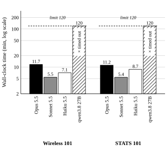
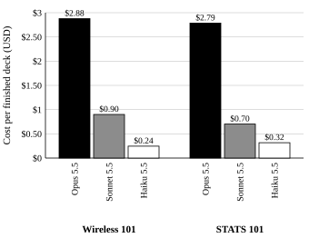
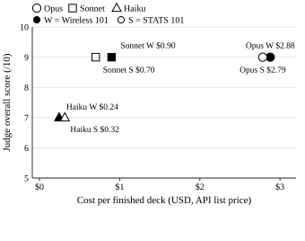
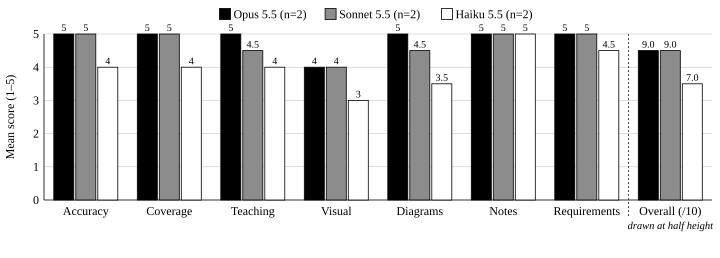
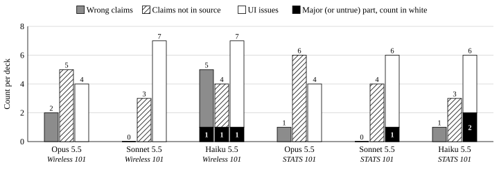
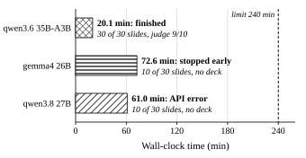

# Cloud vs. Local LLM Agents for Generating Lecture Slides with an Agent Skill: A Preliminary Cost–Time–Quality Study

**Hisham Abuella**
*[Affiliation placeholder]*

---

## Abstract

Coding agents can now build complete slide decks by following a packaged Agent Skill. We ask how cloud and local models compare on that job in time, cost and quality. Three cloud models (Opus 5.5, Sonnet 5.5, Haiku 5.5) and one local model (qwen3.8 27B, served through Ollama on a Mac Studio with an Apple M4 Max) were given the same one-shot request: turn a course module into a 20–30 slide, 50-minute lecture deck using the present-in-html skill in Claude Code. We ran two subjects (Wireless 101, STATS 101). Decks were scored by the skill's checker, by counts, and by a blind LLM judge on seven criteria. All six cloud runs finished in 5.4–11.7 minutes; Opus and Sonnet scored 9/10 on both subjects and Haiku 7/10. The dense local model did not finish within 120 minutes on either subject. In a separate experiment, not compared with these runs, Opus wrote one detailed plan and three local models built from it; one of them, the mixture-of-experts model qwen3.6 35B-A3B, finished a deck the judge scored 9/10. Each cell is a single run, so these are early indications, not firm conclusions.

**Index Terms**: large language models, LLM agents, Agent Skills, slide generation, local inference, mixture of experts, LLM-as-a-judge, cost–quality trade-off.

---

## I. Introduction

Preparing a lecture deck from a course module is slow, repetitive work. Agentic coding tools such as Claude Code can now read a source file, call tools, write HTML and run a checker in one session, guided by a packaged Agent Skill [16]. The question for a lecturer or a small team is practical: which model should run that agent, and is a model on one's own computer good enough?

Cloud models are fast but billed per token. Local models are free per token and keep the material on the machine, but they are smaller and run on consumer hardware. Prior agent benchmarks report a clear gap between commercial and open-weight models in multi-turn tool use [5]. We wanted to see how that gap looks on one concrete, end-to-end authoring task.

This paper reports a small study that runs the same skill, harness and prompt across four models (three cloud, one local) and measures wall-clock time, cost and judged quality. It also reports a separate experiment in which local models build from a plan written by a cloud model. Its contributions are:

- A reproducible harness that runs Claude Code headless [15] with cloud models and with local models through Ollama's Anthropic-compatible endpoint [14], in isolated folders.
- A three-part scoring scheme: the skill's automatic checker, structural counts, and a blind LLM judge with a seven-criterion rubric and itemised findings.
- Results for two subjects, plus a separate experiment in which three local models build from one Opus-written plan, with all prompts, the plan, transcripts, judge outputs and decks released.
- Observations about the skill itself, including a checker gap that lets an unfilled template pass.

In short, the results indicate that Sonnet 5.5 matched Opus 5.5 on judged quality at about half the time and a quarter to a third of the cost, and that the dense local model was too slow to finish unaided. The separate experiment (Section V) indicates that a plan written by a strong model can make a local build feasible.

## II. Related Work

**Slide generation.** DOC2PPT framed document-to-slide generation as a task [8]. PPTAgent generates presentations with an agent that edits reference slides and evaluates them with an LLM-based rubric covering content, design and coherence [9]. AutoPresent generates slides as programs and benchmarks small open models against frontier models [10]. Our setting is closest to AutoPresent: the deck is code (one HTML file), but the generator is a general coding agent driven by a skill rather than a task-specific model.

**Agents and benchmarks.** ReAct describes the interleaved reason–act–observe loop that tool-using agents follow [6]. SWE-bench evaluates agents on long, multi-step software tasks [4], and AgentBench reports that API models lead open-weight models in agentic settings [5]. Agent Skills package instructions, scripts and resources that the agent loads on demand [16]; our task tests one such skill end to end.

**LLM-as-a-judge.** Strong LLM judges agree well with human preferences but show position, verbosity and self-enhancement biases [1]. G-Eval scores text against explicit criteria with an LLM and notes a possible preference for LLM-written text [3]. LLM evaluators can recognise and favour their own generations [2], which matters here because our judge also competes. Our accuracy criterion relies on the notions of faithfulness and factual hallucination surveyed in [11].

**Plan and execute.** ReWOO separates a planner from workers and shows that planning ability can be passed from a large model to a smaller one [7]. Our separate plan experiment (Section V) follows the same split: a cloud model plans once, local models execute.

**Local and MoE inference.** Sparse mixture-of-experts models activate only a subset of parameters per token [12], which lowers compute per token compared with a dense model of similar total size. Two of the local models in this study run in MLX format on Apple silicon [13] and the third, the MoE model, is a Q4_K_M GGUF build (Appendix A); all are served by Ollama, which implements only a subset of the Anthropic Messages API [14].

## III. Study Design and Constraints

### A. Task and Inputs

Each task supplies one Markdown course module and one fixed prompt. The two subjects are Module 1 of *Wireless 101* (waves, decibels, path loss, link budget, modulation, Shannon, multiple access) and Module 1 of *STATS 101* (samples, bias, variable types, graphs, centre, spread, outliers, z-scores, correlation). Both prompts ask for a deck for a 50-minute lecture to first-year undergraduates with these requirements: 20–30 slides in the module's order; only facts, numbers and formulas from the file; animated diagrams where they help; captioned image placeholders; speaker notes on every slide; a quiz and a summary at the end; save as `deck.html` and run the skill's checker until it passes; ask no questions and finish in one go.

The prompts differ in how the skill is invoked. The Wireless prompt begins "Use the present-in-html skill to…", so each model chose to call the skill itself. The STATS prompts begin with the slash command `/present-in-html:present-in-html`, which loads the skill before the first turn.

### B. Models and Hardware

TABLE I lists the models. Cloud models ran through the Anthropic API; local models ran on a single Mac Studio (Apple M4 Max) with 64 GB of unified memory, through Ollama 0.40.5, with Claude Code pointed at Ollama's Anthropic-compatible endpoint [14]. All runs used present-in-html plugin 3.1.0 at commit ae03c20. The full system specifications, including each local model's architecture and quantization, are in Appendix A [19].

**TABLE I**
**MODELS AND WHERE THEY RAN**

| Model | Identifier | Runs on | Tasks |
|---|---|---|---|
| Opus 5.5 | `claude-opus-5-5` | Anthropic API | Wireless 101, STATS 101; also judge, and planner for the plan experiment |
| Sonnet 5.5 | `claude-sonnet-5-5` | Anthropic API | Wireless 101, STATS 101 |
| Haiku 5.5 | `claude-haiku-5-5` | Anthropic API | Wireless 101, STATS 101 |
| qwen3.8 27B (dense) | `qwen3.8:27b-mlx` | Apple M4 Max, 64 GB, Ollama 0.40.5 | Wireless 101, STATS 101; also plan experiment |
| qwen3.6 35B-A3B (MoE, 3B active) | `qwen3.6:35b-a3b` | Apple M4 Max, 64 GB, Ollama 0.40.5 | Plan experiment only |
| gemma4 26B | `gemma4:26b-mlx` | Apple M4 Max, 64 GB, Ollama 0.40.5 | Plan experiment only |

**TABLE II**
**RUN SETTINGS PER TASK**

| Task | Run ID | Claude Code | Time limit | Cloud budget cap |
|---|---|---|---|---|
| Wireless 101 | 20261016-000644 | 2.1.301 | 120 min | $20 per run |
| STATS 101 | 20261016-063639-stats-101 | 2.1.301 | 120 min | $20 per run |
| STATS 101 + plan (plan experiment, Section V) | 20261016-214018-stats-101-planned | 2.1.302 | 240 min | $20 per run |

### C. Harness and Isolation

Each run starts in a new empty folder created outside the repository, holding only the source module (and, for the planned task, the plan). The folder is outside the repository because Claude Code reads `CLAUDE.md` from parent folders; the script refuses to start if any parent folder has a `CLAUDE.md` or `.claude`. The CLI runs headless [15] with no settings files (`--setting-sources ""`), only the study's plugin (`--plugin-dir`) besides the CLI's three built-in plugins, no MCP servers or claude.ai connectors (`--strict-mcp-config`), no saved session, permissions bypassed, and each model's default effort.

Runs execute one at a time so they do not compete for CPU, GPU or network. Each local model is loaded into memory before its clock starts, so load time is not counted. The CLI's `init` event is saved in each transcript, so the loaded plugins and MCP servers can be checked after the fact.

### D. Plan Experiment (Reported Separately)

Separately from the main comparison, we ran an experiment to help local models finish; it is reported in Section V and is not part of the comparison. For this planned task, Opus 5.5 first wrote one `PLAN.md` with a plan-only prompt. That prompt asks for every slide's exact text and full speaker notes, ready-to-paste SVG for each diagram, and numbered build steps with shell commands, because the plan "will be built … by a smaller, much slower local model that has never used this skill." Planning took 23m 20s, 51 turns and 101,973 output tokens, cost $5.05 ($5.046), and produced a 94 KB plan.

The plan was patched by hand in two places before the builds: the folder variable `D` was set to `$PWD` (it held the planner's temp folder) and the deck file was renamed `deck.html` to match the build prompt. Each local model then received the build prompt, which tells it to follow the plan's build steps, not to re-plan, and not to read the skill's reference files unless a step says so.

### E. Scoring

Every deck is scored three ways. First, the skill's checker (`check.mjs`) tests layout, text outside the safe area, text size, contrast, broken charts and missing notes, and takes a screenshot of every slide. Second, a counting script records slides, slides with notes, diagrams, animated slides, image placeholders and whether a quiz is present.

Third, a blind judge (Opus 5.5, `claude-opus-5-5`) grades each deck separately without being told which model made it, in the spirit of rubric-based LLM evaluation [1], [3]. It reads the source, the request, the slide text and notes, the checker output and every screenshot. It returns structured output [15] that lists each wrong claim (slide, quote, correction, major/minor), each claim not in the source and whether it is true, each UI issue seen in the screenshots, and the major mistakes. It scores seven criteria from 1 to 5: accuracy, coverage, teaching, visual, diagrams, notes and requirements. It then gives an overall score from 1 to 10 for "how ready this deck is to teach from tomorrow."

Time is wall-clock time for the whole run; API time is time spent waiting on the model. Cost is the CLI's reported `total_cost_usd`, which the documentation describes as a client-side estimate [15]. The CLI also prints a price for local runs, which is not a real charge; we record local runs as $0 and do not count electricity. The judge's cost ($0.61–$0.74 per finished deck) is kept separate.

### F. Constraints and Threats to Validity

- **One sample per cell.** Each model ran once per task (n = 1). LLM outputs vary between runs even with fixed settings [18], and score differences smaller than benchmark variance are not meaningful [17].
- **Judge self-preference.** The judge, Opus 5.5, is also one of the models compared, and the other two cloud models are from the same family. LLM judges can favour their own outputs [2], [1]. Blinding hides the model name but not the style.
- **Cost is an estimate.** Cloud costs are the CLI's client-side list-price estimate [15], not an invoice.
- **Different settings for the planned run.** It used Claude Code 2.1.302 with a 240-minute limit; the other runs used 2.1.301 with 120 minutes. For this reason, and because its input differs, it is reported as a separate experiment and not compared with the main runs.
- **Hand-patched plan.** Two paths in the Opus plan were fixed by hand. The `plan-prompt.txt` in the artifacts is the revised version, which now asks for both paths.
- **One machine.** All local results come from a single M4 Max with 64 GB; other hardware would give different times.
- **Partial API.** Ollama implements only a subset of the Anthropic Messages API [14], which may affect local tool use and streaming.
- **Prompt and rubric wording.** The Wireless prompt asks the model to use the skill, while the STATS prompts load it with a slash command. The Wireless run was judged with the audience and requirements written into the rubric; the STATS runs read them from the request.

## IV. Results

This section covers the main comparison: the eight runs on Wireless 101 and STATS 101. TABLE III gives their results. The separate experiment of Section V is not included here.

**TABLE III**
**MAIN RESULTS FOR THE TWO MAIN TASKS (ONE RUN PER CELL)**

| Task | Model | Runs on | Status | Wall time | Cost (USD) | Slides | Checker | Wrong claims (major) | UI issues (major) | Judge /10 |
|---|---|---|---|---|---|---|---|---|---|---|
| Wireless 101 | Opus 5.5 | Cloud | finished | 11m 44s | 2.88 | 30 | pass | 2 (0) | 4 (0) | **9** |
| Wireless 101 | Sonnet 5.5 | Cloud | finished | 5m 27s | 0.90 | 30 | pass | 0 (0) | 7 (0) | **9** |
| Wireless 101 | Haiku 5.5 | Cloud | finished | 7m 05s | 0.24 | 29 | pass | 5 (1) | 7 (1) | **7** |
| Wireless 101 | qwen3.8 27B | Local | timed out | 120m 00s | 0 | – | – | – | – | unfinished |
| STATS 101 | Opus 5.5 | Cloud | finished | 11m 14s | 2.79 | 30 | pass | 1 (0) | 4 (0) | **9** |
| STATS 101 | Sonnet 5.5 | Cloud | finished | 5m 24s | 0.70 | 29 | pass | 0 (0) | 6 (1) | **9** |
| STATS 101 | Haiku 5.5 | Cloud | finished | 8m 44s | 0.32 | 29 | pass | 1 (0) | 6 (2) | **7** |
| STATS 101 | qwen3.8 27B | Local | timed out | 120m 00s | 0 | – | – | – | – | unfinished |

*Cost is the CLI's client-side estimate for cloud runs; local runs are recorded as $0 (electricity not counted). The judge's cost is not included. For the two timed-out qwen3.8 27B runs, the file left on disk was the template with its sample slides unchanged, which passed the checker and was scored 1/10 (Section IV-F).*

### A. Time

All six cloud runs finished, between 5m 24s (Sonnet, STATS) and 11m 44s (Opus, Wireless) (Fig. 1). Sonnet was the fastest on both subjects, at 5m 27s and 5m 24s, about half of Opus's 11m 44s and 11m 14s. Haiku was slower than Sonnet on both subjects (7m 05s and 8m 44s) and used more turns (37 and 46) and more output tokens (68,384 and 90,031) than Sonnet (29 and 22 turns; 38,188 and 29,603 tokens).

qwen3.8 27B reached the 120-minute limit on both subjects, after 19 and 22 tool calls.

### B. Cost

Cloud cost per finished deck ranged from $0.24 (Haiku, Wireless) to $2.88 (Opus, Wireless) (Fig. 2). Sonnet cost $0.90 and $0.70, which is 31% and 25% of Opus's $2.88 and $2.79. Haiku cost $0.24 and $0.32.

### C. Quality

TABLE IV gives the judge's criterion scores, and Fig. 3 plots overall score against cost. Opus and Sonnet scored 9/10 on both subjects and Haiku 7/10 on both. Every finished deck passed the checker with 0 issues and had speaker notes on every slide and a quiz.

**TABLE IV**
**JUDGE SCORES FOR FINISHED DECKS (CRITERIA 1–5, OVERALL 1–10)**

| Task | Model | Accuracy | Coverage | Teaching | Visual | Diagrams | Notes | Requirements | Overall |
|---|---|---|---|---|---|---|---|---|---|
| Wireless 101 | Opus 5.5 | 5 | 5 | 5 | 4 | 5 | 5 | 5 | **9** |
| Wireless 101 | Sonnet 5.5 | 5 | 5 | 4 | 4 | 4 | 5 | 5 | **9** |
| Wireless 101 | Haiku 5.5 | 4 | 4 | 4 | 3 | 3 | 5 | 5 | **7** |
| STATS 101 | Opus 5.5 | 5 | 5 | 5 | 4 | 5 | 5 | 5 | **9** |
| STATS 101 | Sonnet 5.5 | 5 | 5 | 5 | 4 | 5 | 5 | 5 | **9** |
| STATS 101 | Haiku 5.5 | 4 | 4 | 4 | 3 | 4 | 5 | 4 | **7** |

Fig. 4 shows the mean criterion scores per model. No deck scored 5 on visual; Opus and Sonnet averaged 4.0 and Haiku 3.0. The models differed most on diagrams (Opus 5.0, Sonnet 4.5, Haiku 3.5). The diagram counts only partly match these scores: Opus drew 13 and 11 diagrams, Sonnet 10 and 7, and Haiku 4 and 7. Opus also wrote the longest notes (3,042 and 2,962 words).

### D. Errors and UI Issues

Fig. 5 counts the judge's findings per deck. Sonnet had no wrong claims on either subject. Opus had 2 and 1, all minor; for example, on Wireless it wrote "Wi-Fi, Bluetooth, microwaves" where the source says microwave ovens. Haiku had 5 wrong claims on Wireless (1 major) and 1 on STATS. Every deck had some claims not in the source (3–6), and the judge marked only one of them untrue (Haiku, Wireless).

Each deck had 4–7 UI issues. Most were minor, such as cramped columns and labels touching shapes. The major ones were concrete. On Sonnet's STATS deck, "the eyebrow label 'The plan' sits on top of the title 'Three questions'." On Haiku's STATS deck, the x̄ symbol rendered broken, so the standard deviation formula could read "(x − x)², which is zero." On Haiku's Wireless deck, "'electromagnetic' runs into the Hertz column and overlaps 'radio waves'."

The judge also listed major mistakes that are not UI faults. Haiku reordered the STATS sections ("Population (6), Sampling (7–8), Bias (9), Study design (10), Types of variables (11)…"), which the request forbade. Opus had no major mistakes on either subject.

### E. Unfinished Local Runs

qwen3.8 27B finished neither subject in 120 minutes (TABLE V). On Wireless it wrote a `PLAN.md` but no slides. On STATS it wrote 20 slides (17 with notes) in two part files but never assembled `deck.html`.

**TABLE V**
**PARTIAL PROGRESS OF UNFINISHED LOCAL RUNS**

| Task | Model | Status | Wall time | Slides written in parts | With notes | Part files | Template `deck.html` scored |
|---|---|---|---|---|---|---|---|
| Wireless 101 | qwen3.8 27B | timed out | 120m 00s | 0 | 0 | – | 21 slides, checker pass, judge 1/10 |
| STATS 101 | qwen3.8 27B | timed out | 120m 00s | 20 | 17 | part1.html, part2.html | 21 slides, checker pass, judge 1/10 |

### F. Observations About the Skill Itself

**The checker passes an unfinished deck.** In both timed-out qwen3.8 27B runs, `deck.html` was still the skill's template, with "Your Name," "you@example.com" and a revenue chart. The checker passed it with 0 issues, while the judge scored it 1/10 and noted "only the footer was changed." The checker tests layout, not content, so a rule for template leftovers is needed.

**Plan field names leak into decks.** "Fence" is a heading in the skill's `PLAN.md` format. Haiku put "Fence: gain does not add energy…" on Wireless slide 9, which the judge called a major mistake that "would embarrass the lecturer." Sonnet's Wireless deck has "Fence:" twice in its speaker notes, and the word also appears in the speaker notes of the STATS decks (Sonnet twice, Haiku once). The revised plan-only prompt now states that such field names must stay out of slides and notes.

**The judge catches what the checker cannot.** All six finished decks passed the checker with 0 issues. The judge still found overlapping labels inside diagrams, a reflected ray that misses the receiver (Sonnet, Wireless), the broken x̄ symbol, and sections out of order. A screenshot-reading judge appears to be a useful complement to rule-based checks.

## V. Experiment: A Shared Plan to Help Local Models

This section reports a separate experiment. It is not part of the cloud-versus-local comparison in Section IV, and its results are not ranked against the runs there.

### A. Motivation

In the main comparison, the local model was too slow to finish unaided: qwen3.8 27B reached the 120-minute limit on both subjects (Section IV-E). Much of a run goes into reading the skill and designing the deck before any slide is written. We therefore asked whether a detailed plan, written once by a strong cloud model, would let local models build a full deck.

### B. Setup

Opus 5.5 wrote one `PLAN.md` for STATS 101 once, in 23m 20s for $5.05 (Section III-D). The plan was patched by hand in two places before the builds: the folder variable `D` and the deck's file name. Three local models then built from it: qwen3.6 35B-A3B (MoE, 3B active), gemma4 26B and qwen3.8 27B. Each received the module, the plan and a build prompt that tells it to follow the plan's build steps. The run used a 240-minute limit and Claude Code 2.1.302 (TABLE II); the harness, machine, Ollama version, checker and judge were the same as in Section III. Each model ran once.

### C. Outcomes

TABLE VI and Fig. 6 give the outcomes.

**TABLE VI**
**PLAN EXPERIMENT: LOCAL MODELS BUILDING FROM THE OPUS PLAN (ONE RUN EACH)**

| Model | Status | Wall time | Slides | Checker | Wrong claims (major) | UI issues (major) | Judge /10 |
|---|---|---|---|---|---|---|---|
| qwen3.6 35B-A3B | finished | 20m 07s | 30 | pass | 0 (0) | 5 (0) | **9** |
| gemma4 26B | stopped early | 72m 34s | 10 in part 1, not assembled | – | – | – | unfinished |
| qwen3.8 27B | API error | 61m 03s | 10 in part 1, not assembled | – | – | – | unfinished |

*Local runs are recorded as $0; the $5.05 plan was paid once. The unfinished runs left no `deck.html` and were not judged.*

**qwen3.6 35B-A3B** was the only model to finish. It built a 30-slide deck in 20m 07s, of which 19m 37s was API time, with 31 turns and 30 tool calls. The deck passed the checker with 0 issues and had speaker notes on every slide and a quiz. The judge scored it 9/10 (accuracy 5, coverage 5, teaching 5, visual 4, diagrams 4, notes 4, requirements 5) and found no wrong claims. Its one major mistake was in the quiz notes, which say "then to reveal" without saying how. The deck had 10 diagrams and 2,830 words of notes.

**gemma4 26B** wrote part 1 (10 slides, all with notes), but it rewrote that file eight times (four more Write calls failed for lack of a file path) and then ended its turn saying it would "now proceed to build Part 2." In headless one-shot mode, ending the turn ends the run, and the CLI reported the run as completed with exit code 0 even though no deck existed.

**qwen3.8 27B** wrote part 1 (10 slides, all with notes) and was writing part 2 when it failed after 61 minutes with "API Error: The response stopped arriving."

Within this experiment, output rates differed widely: about 3,575 output tokens per API minute for qwen3.6 35B-A3B, against about 182 for qwen3.8 27B and about 745 for gemma4 26B (output tokens divided by API minutes, which also include prompt processing). This fits the expectation that a sparse model with 3B active parameters generates faster than a dense 27B model on the same hardware [12].

These outcomes suggest two different local failure modes: speed (the dense 27B model) and turn control (gemma4 ending its turn early). The plan removed most of the reading and design work, which the MoE model could then turn into a full deck. The qwen3.8 27B stream failure may relate to Ollama's partial API support [14] or to long generations between streamed chunks; we did not isolate the cause.

### D. Scope of the Experiment

This is not a like-for-like comparison with the main runs. The input differs (a finished plan as well as the module), the settings differ (a 240-minute limit and Claude Code 2.1.302), only local models built from the plan, and only one of three builds finished. We therefore present it only as an indication that a plan from a strong model can make a local build feasible, not as evidence about how local models rank against cloud models. Section IX lists the tests needed to compare the two routes properly.

## VI. Discussion

Within the limits of single runs, the results suggest a value ordering among the cloud models. Sonnet 5.5 matched Opus 5.5 on the overall score on both subjects, with no wrong claims, in about half the time and at 25–31% of the cost. Opus produced the most diagrams and the highest diagram scores, so it may still be the better choice when diagrams carry the lecture. Haiku was the cheapest, but in each subject it made at least one mistake a lecturer would have to fix before teaching.

The local results suggest that, on this hardware, the main barrier for a dense local model is speed rather than ability. The dense 27B model produced reasonable slides when it got to them but ran out of time.

A practical lesson is that "the run finished" and "the checker passed" are not the same as "the deck is done." Two runs left the template in place and passed, and one run in the experiment of Section V ended with exit code 0 and no deck. Any automated pipeline built on such agents needs a content-level completion check.

## VII. Disclaimer and Limitations

> **These are early indications from single runs.** Each model was run once per task (n = 1), on one machine, with one judge from the same model family as three of the six models. LLM outputs vary between runs even under fixed settings [18], and differences smaller than benchmark variance are not meaningful [17]. Differences of one point on a 10-point judge score, or of a few minutes in wall time, are within the range we would expect from noise; the two-point gap between Haiku and the larger models held on both tasks but also needs repeated runs to confirm. More repeated tests, ideally with confidence intervals, a cross-family judge and human raters, are needed before drawing firm conclusions. Cost figures are client-side estimates, and local costs exclude electricity.

## VIII. Conclusion

We compared three cloud LLMs and one local LLM on building a 50-minute lecture deck with an Agent Skill in Claude Code, measuring time, cost and blind-judged quality. In this small study, all cloud runs finished within 12 minutes, and Sonnet 5.5 matched Opus 5.5's 9/10 at a lower cost and in less time. The dense local model did not finish unaided. In a separate experiment, not compared with these runs, one of three local models built a deck the judge scored 9/10 from an Opus-written plan, an indication that such a plan can make a local build feasible. The study also found that the skill's checker passes an untouched template, which a content check would fix. These findings are preliminary and need repeated runs to confirm.

## IX. Future Work and Planned Tests

1. **Repeated runs.** Run each model–task cell several times (e.g., 5 per cell) and report means with confidence intervals for time, cost and scores [17], [18].
2. **More tasks and subjects.** Add modules from other fields, other lengths and other languages, including right-to-left decks.
3. **Independent judging.** Use a judge from a different model family, several judges, or human raters, and measure their agreement with the current judge [1], [2].
4. **Repeated planned builds.** Build each local model from the same plan several times to measure how often a planned local build finishes and how much its quality varies.
5. **Cloud models built from the plan as a control.** Run Opus, Sonnet and Haiku on the planned task, with the same CLI version and time limit as the local builds, to separate the effect of the plan from the effect of the builder. Write plans for both subjects so that planned and unplanned builds can be compared like for like.
6. **Amortising the plan cost.** Build one plan several times, for example after edits, in several themes or languages, or locally to keep material on the machine, and report the plan cost per finished deck, counting failed builds.
7. **More local models and quantizations.** Test further MoE and dense models and several quantization levels on the same hardware.
8. **Finer measurements.** Record time to first slide and energy use per deck, so local runs have a real cost figure.
9. **Checker rule for template leftovers.** Fail any deck that still contains template content such as placeholder names, e-mail addresses or sample charts.
10. **Streaming-timeout fix.** Investigate and fix the stream stopping during long local generations, then rerun qwen3.8 27B on the planned task.
11. **Different hardware.** Repeat the local runs on other machines, including smaller laptops and a desktop GPU.

## Artifacts and Reproducibility

All links are relative to the `paper/` folder.

**Prompts.**
- Wireless 101 build prompt: [`../study/tasks/wireless-101/prompt.txt`](../tasks/wireless-101/prompt.txt)
- STATS 101 build prompt: [`../study/tasks/stats-101/prompt.txt`](../tasks/stats-101/prompt.txt)
- STATS 101 planned build prompt: [`../study/tasks/stats-101-planned/prompt.txt`](../tasks/stats-101-planned/prompt.txt)
- Plan-only prompt (revised version, see Section III-F): [`../study/tasks/stats-101-planned/plan-prompt.txt`](../tasks/stats-101-planned/plan-prompt.txt)
- Judge prompt: [`../study/scripts/judge-prompt.txt`](../judge-prompt.txt)
- Judge output schema: [`../study/scripts/judge-schema.json`](../judge-schema.json)

**Input modules.**
- Wireless 101, Module 1: [`../study/tasks/wireless-101/wireless-101-module-1.md`](../tasks/wireless-101/wireless-101-module-1.md)
- STATS 101, Module 1: [`../study/tasks/stats-101/stats-101-module-1.md`](../tasks/stats-101/stats-101-module-1.md)
- STATS 101, Module 1 (copy used by the planned task): [`../study/tasks/stats-101-planned/stats-101-module-1.md`](../tasks/stats-101-planned/stats-101-module-1.md)

**Shared plan.**
- The plan as built from (after the two hand patches): [`../study/tasks/stats-101-planned/PLAN.md`](../tasks/stats-101-planned/PLAN.md)
- Planner time, cost and patch note: [`../study/tasks/stats-101-planned/plan.json`](../tasks/stats-101-planned/plan.json)
- Planner transcript: [`../study/tasks/stats-101-planned/plan-transcript.jsonl`](../tasks/stats-101-planned/plan-transcript.jsonl)

**Scripts.**
- Run harness: [`../study/scripts/run.sh`](../run.sh)
- Planner: [`../study/scripts/plan.sh`](../plan.sh)
- Checker, counts and judge: [`../study/scripts/evaluate.sh`](../evaluate.sh)
- Slide and notes extraction: [`../study/scripts/extract-slides.mjs`](../extract-slides.mjs)
- Report generator: [`../study/scripts/report.mjs`](../report.mjs)
- Figures and data tables for this paper: [`make-figures.mjs`](make-figures.mjs), [`data/tables.md`](data/tables.md), [`data/study-data.json`](data/study-data.json)
- Study design and results notes: [`../study/README-original.md`](../README.md), [`../study/RESULTS.md`](../RESULTS.md)

**Per-run results** (each folder holds the prompt, source, `run.json`, `results.json`, and per model the transcript, checker output, screenshots, slide text and `judge.json`).
- Wireless 101: [`../results/20261016-000644/REPORT.md`](../results/20261016-000644/REPORT.md)
- STATS 101: [`../results/20261016-063639-stats-101/REPORT.md`](../results/20261016-063639-stats-101/REPORT.md)
- STATS 101 + plan (plan experiment, Section V): [`../results/20261016-214018-stats-101-planned/REPORT.md`](../results/20261016-214018-stats-101-planned/REPORT.md)

**TABLE VII**
**GENERATED DECKS, MAIN COMPARISON**

| Task | Model | Status | Slides | Judge /10 | Deck |
|---|---|---|---|---|---|
| Wireless 101 | Opus 5.5 | finished | 30 | 9 | [`../decks/wireless-101_opus.html`](../decks/wireless-101_opus.html) |
| Wireless 101 | Sonnet 5.5 | finished | 30 | 9 | [`../decks/wireless-101_sonnet.html`](../decks/wireless-101_sonnet.html) |
| Wireless 101 | Haiku 5.5 | finished | 29 | 7 | [`../decks/wireless-101_haiku.html`](../decks/wireless-101_haiku.html) |
| Wireless 101 | qwen3.8 27B | timed out, no slides written | – | – | no deck |
| STATS 101 | Opus 5.5 | finished | 30 | 9 | [`../decks/stats-101_opus.html`](../decks/stats-101_opus.html) |
| STATS 101 | Sonnet 5.5 | finished | 29 | 9 | [`../decks/stats-101_sonnet.html`](../decks/stats-101_sonnet.html) |
| STATS 101 | Haiku 5.5 | finished | 29 | 7 | [`../decks/stats-101_haiku.html`](../decks/stats-101_haiku.html) |
| STATS 101 | qwen3.8 27B | **PARTIAL**: timed out; assembled after the fact | 20 | not judged | [`../decks/PARTIAL_stats-101_qwen3.8-27b.html`](../decks/PARTIAL_stats-101_qwen3.8-27b.html) |

**TABLE VIII**
**GENERATED DECKS, PLAN EXPERIMENT (SECTION V)**

| Task | Model | Status | Slides | Judge /10 | Deck |
|---|---|---|---|---|---|
| STATS 101 + plan | qwen3.6 35B-A3B | finished | 30 | 9 | [`../decks/stats-101-planned_qwen3.6-35b-a3b.html`](../decks/stats-101-planned_qwen3.6-35b-a3b.html) |
| STATS 101 + plan | qwen3.8 27B | **PARTIAL**: API error; assembled after the fact | 10 | not judged | [`../decks/PARTIAL_stats-101-planned_qwen3.8-27b.html`](../decks/PARTIAL_stats-101-planned_qwen3.8-27b.html) |
| STATS 101 + plan | gemma4 26B | **PARTIAL**: stopped early; assembled after the fact | 10 | not judged | [`../decks/PARTIAL_stats-101-planned_gemma4-26b.html`](../decks/PARTIAL_stats-101-planned_gemma4-26b.html) |

*The three PARTIAL decks (one in TABLE VII, two in TABLE VIII) were not made by the models. The author assembled them after the runs from the slide part files the unfinished local models wrote, so their slides can be viewed. They were not checked or judged and are not counted in any result. The judge scores of 1/10 in TABLE V refer to the template (sample slides unchanged) left as `deck.html`, not to these files.*

## Appendix A. System Specifications

The harness, the checker and the local models ran on the machine in TABLE A-I. The values were collected from it with `system_profiler`, `sw_vers` and `ollama show` / `ollama list`. Apple's specification page for the Mac Studio (2025) lists this M4 Max configuration (16-core CPU, 40-core GPU) with 64 GB of memory and 1 TB of storage as options [19].

**TABLE A-I**
**HARDWARE AND SOFTWARE**

| Item | Value |
|---|---|
| Machine | Mac Studio, model identifier Mac16,9 [19] |
| Chip | Apple M4 Max, 16-core CPU (12 performance + 4 efficiency), 40-core GPU |
| Memory | 64 GB unified |
| Storage | 1 TB SSD (926 GiB volume) |
| Operating system | macOS 26.3 (build 25D125), arm64 |
| Claude Code | 2.1.301 (Wireless 101 and STATS 101 runs); 2.1.302 (plan experiment and its judging) |
| Ollama | 0.40.5 |
| Node.js | v24.12.0 |
| Screenshots for the checker | Playwright 1.64.1 (Chromium) |
| JPEG conversion | macOS `sips` |
| Cloud models | `claude-opus-5-5`, `claude-sonnet-5-5`, `claude-haiku-5-5` through the Anthropic API, each at its default effort; judge `claude-opus-5-5` |

**TABLE A-II**
**LOCAL MODELS (FROM `ollama show` AND `ollama list`)**

| Model tag | Architecture | Parameters | Quantization | Format | Context | Size | Used in |
|---|---|---|---|---|---|---|---|
| `qwen3.8:27b-mlx` | qwen3_5 | 27.8B (dense) | nvfp4 | MLX | 262,144 | 18 GB | Main comparison; plan experiment |
| `qwen3.6:35b-a3b` | qwen35moe | 35.5B (MoE, about 3B active) | Q4_K_M | GGUF | 262,144 | 22 GB | Plan experiment |
| `gemma4:26b-mlx` | gemma4 | 26.2B | nvfp4 | MLX | 262,144 | 18 GB | Plan experiment |

*All three local models ran with tool calling and thinking enabled and Ollama's default settings. Whether gemma4 26B is dense or a mixture of experts is not confirmed here.*

## References

[1] L. Zheng, W.-L. Chiang, Y. Sheng, S. Zhuang, Z. Wu, Y. Zhuang, Z. Lin, Z. Li, D. Li, E. P. Xing, H. Zhang, J. E. Gonzalez, and I. Stoica, "Judging LLM-as-a-judge with MT-Bench and Chatbot Arena," in *Advances in Neural Information Processing Systems 36 (NeurIPS 2023), Datasets and Benchmarks Track*, 2023, pp. 46595–46623. [Online]. Available: https://arxiv.org/abs/2306.05685

[2] A. Panickssery, S. R. Bowman, and S. Feng, "LLM evaluators recognize and favor their own generations," in *Advances in Neural Information Processing Systems 37 (NeurIPS 2024)*, 2024, pp. 68772–68802, doi: 10.52202/079017-2197. [Online]. Available: https://arxiv.org/abs/2404.13076

[3] Y. Liu, D. Iter, Y. Xu, S. Wang, R. Xu, and C. Zhu, "G-Eval: NLG evaluation using GPT-4 with better human alignment," in *Proc. 2023 Conf. Empirical Methods in Natural Language Processing (EMNLP)*, Singapore, 2023, pp. 2511–2522, doi: 10.18653/v1/2023.emnlp-main.153.

[4] C. E. Jimenez, J. Yang, A. Wettig, S. Yao, K. Pei, O. Press, and K. Narasimhan, "SWE-bench: Can language models resolve real-world GitHub issues?" in *Proc. Int. Conf. Learning Representations (ICLR)*, 2024. [Online]. Available: https://arxiv.org/abs/2310.06770

[5] X. Liu, H. Yu, H. Zhang, Y. Xu, X. Lei, H. Lai, Y. Gu, H. Ding, K. Men, K. Yang *et al.*, "AgentBench: Evaluating LLMs as agents," in *Proc. Int. Conf. Learning Representations (ICLR)*, 2024. [Online]. Available: https://arxiv.org/abs/2308.03688

[6] S. Yao, J. Zhao, D. Yu, N. Du, I. Shafran, K. Narasimhan, and Y. Cao, "ReAct: Synergizing reasoning and acting in language models," in *Proc. Int. Conf. Learning Representations (ICLR)*, 2023. [Online]. Available: https://arxiv.org/abs/2210.03629

[7] B. Xu, Z. Peng, B. Lei, S. Mukherjee, Y. Liu, and D. Xu, "ReWOO: Decoupling reasoning from observations for efficient augmented language models," arXiv preprint arXiv:2305.18323, 2023. [Online]. Available: https://arxiv.org/abs/2305.18323

[8] T.-J. Fu, W. Y. Wang, D. McDuff, and Y. Song, "DOC2PPT: Automatic presentation slides generation from scientific documents," in *Proc. AAAI Conf. Artificial Intelligence*, vol. 36, no. 1, 2022, pp. 634–642, doi: 10.1609/aaai.v36i1.19943.

[9] H. Zheng, X. Guan, H. Kong, W. Zhang, J. Zheng, W. Zhou, H. Lin, Y. Lu, X. Han, and L. Sun, "PPTAgent: Generating and evaluating presentations beyond text-to-slides," in *Proc. 2025 Conf. Empirical Methods in Natural Language Processing (EMNLP)*, Suzhou, China, 2025, pp. 14402–14418, doi: 10.18653/v1/2025.emnlp-main.728.

[10] J. Ge, Z. Z. Wang, X. Zhou, Y.-H. Peng, S. Subramanian, Q. Tan, M. Sap, A. Suhr, D. Fried, G. Neubig, and T. Darrell, "AutoPresent: Designing structured visuals from scratch," in *Proc. IEEE/CVF Conf. Computer Vision and Pattern Recognition (CVPR)*, 2025, pp. 2902–2911, doi: 10.1109/CVPR52734.2025.00276. [Online]. Available: https://arxiv.org/abs/2501.00912

[11] L. Huang, W. Yu, W. Ma, W. Zhong, Z. Feng, H. Wang, Q. Chen, W. Peng, X. Feng, B. Qin, and T. Liu, "A survey on hallucination in large language models: Principles, taxonomy, challenges, and open questions," *ACM Trans. Inf. Syst.*, vol. 43, no. 2, pp. 1–55, 2025, doi: 10.1145/3703155. [Online]. Available: https://arxiv.org/abs/2311.05232

[12] W. Fedus, B. Zoph, and N. Shazeer, "Switch Transformers: Scaling to trillion parameter models with simple and efficient sparsity," *J. Mach. Learn. Res.*, vol. 23, no. 120, pp. 1–39, 2022. [Online]. Available: https://jmlr.org/papers/v23/21-0998.html

[13] A. Hannun, J. Digani, A. Katharopoulos, and R. Collobert, "MLX: Efficient and flexible machine learning on Apple silicon," GitHub repository, 2023. [Online]. Available: https://github.com/ml-explore/mlx

[14] Ollama, "Anthropic compatibility," Ollama documentation. Accessed: Oct. 17, 2026. [Online]. Available: https://docs.ollama.com/api/anthropic-compatibility

[15] Anthropic, "Run Claude Code programmatically," Claude Code documentation. Accessed: Oct. 17, 2026. [Online]. Available: https://code.claude.com/docs/en/headless

[16] B. Zhang, K. Lazuka, and M. Murag, "Equipping agents for the real world with Agent Skills," Anthropic Engineering Blog, Oct. 16, 2025. [Online]. Available: https://www.anthropic.com/engineering/equipping-agents-for-the-real-world-with-agent-skills

[17] L. Madaan, A. K. Singh, R. Schaeffer, A. Poulton, S. Koyejo, P. Stenetorp, S. Narang, and D. Hupkes, "Quantifying variance in evaluation benchmarks," arXiv preprint arXiv:2406.10229, 2024. [Online]. Available: https://arxiv.org/abs/2406.10229

[18] B. Atil, S. Aykent, A. Chittams, L. Fu, R. J. Passonneau, E. Radcliffe, G. R. Rajagopal, A. Sloan, T. Tudrej, F. Ture, Z. Wu, L. Xu, and B. Baldwin, "Non-determinism of 'deterministic' LLM settings," arXiv preprint arXiv:2408.04667, 2024. [Online]. Available: https://arxiv.org/abs/2408.04667

[19] Apple, "Mac Studio (2025) - Tech Specs," Apple Support. Accessed: Oct. 17, 2026. [Online]. Available: https://support.apple.com/en-us/122211
